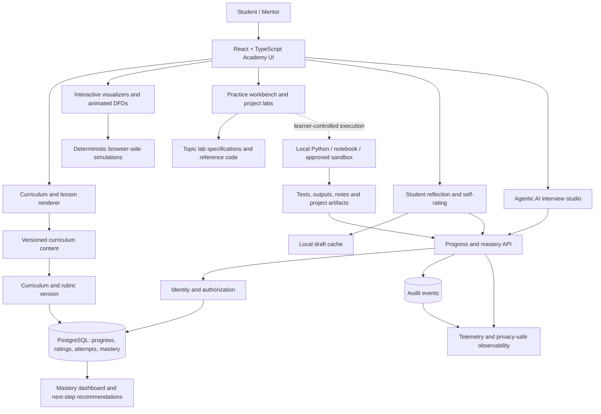
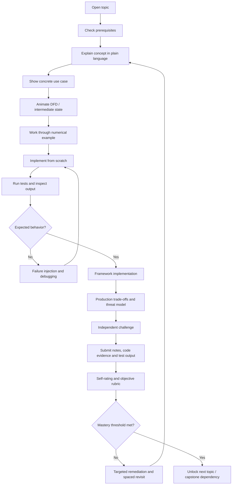
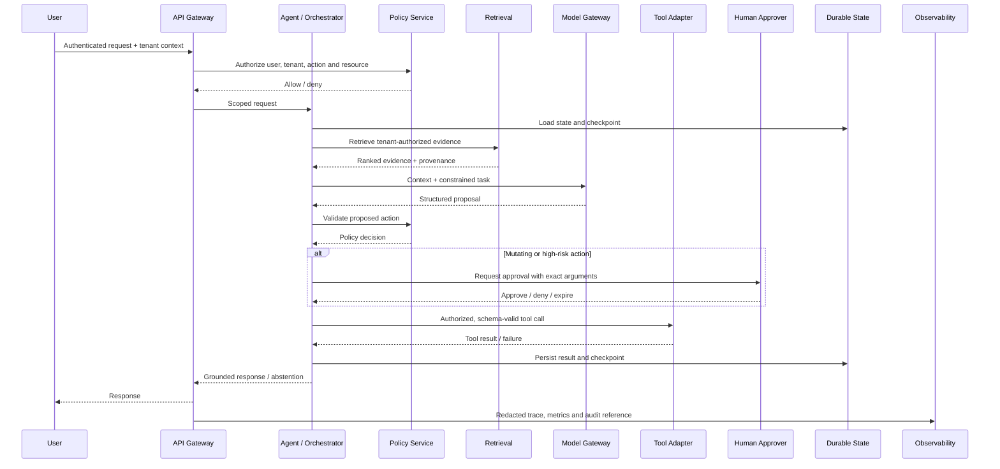

# Senior Architect Review — AI Engineering Academy

> **Historical baseline notice (22 Nov 2026):** This document was written against the earlier 11-stage / 84-topic curriculum. The current main-branch inventory is 12 stages / 93 unique topics. Use [the current complete architect review](COMPLETE_ACADEMY_ARCHITECT_REVIEW_2026-11-22.md) and [Topic Learning Studio contract](TOPIC_LEARNING_STUDIO_CONTRACT.md) for current scope and priorities. This document remains useful for its original per-topic findings and quality model.

**Review baseline:** `main` at `9db2718345d4bb44ed38125994bfaf732471cf6e` (20 Nov 2026)  
**Scope:** 11 stages, 84 lesson topics, lesson data model, topic lab packs, practice workbench, interactive labs, production playbooks, architecture documentation and learner progress UX.  
**Review type:** Repository-based expert desk review. Scores describe the current published learning experience, not the quality of a learner or a claim that every code sample has been executed.

## Executive assessment

The Academy has a strong curriculum map and a credible hands-on skeleton: all 84 topics have lab specifications, all 11 stages have theory guides, the app has focused numerical workbenches for selected foundations, and the production playbooks cover RAG, multi-agent orchestration, fine-tuning and deployment. The Agentic AI Interview Studio is merged.

However, **the current Academy is not yet a consistent zero-to-expert teaching product**. Its most important weakness is the gap between a topic being listed and that topic being taught deeply. The current `lesson()` factory supplies generic intuition, generic examples and generic workflow steps to lessons without explicit overrides. Only 31 lesson IDs have bespoke lesson-content overrides in `curriculum.ts`; the interactive code workbench has bespoke starter implementations for only 16 IDs. The 84 lab specifications are useful task briefs, but most do not contain a complete, tested reference implementation. Stage guides are compact overviews, not full explanations. Visualizations are concentrated in selected labs rather than present for every topic. The current student journey records completion/bookmarks in browser storage but does not ask the learner to rate readability, difficulty, understanding, confidence or implementation challenges after practice.

**Architectural verdict:** good curriculum breadth and a sound learning-workbench foundation; incomplete instructional depth, uneven topic implementation, insufficient visual coverage, and insufficient evidence-based learner mastery.

## Overall scorecard

Scores are on a 1–5 scale. 1 = absent/very weak, 2 = introductory or generic, 3 = useful but incomplete, 4 = strong and independently usable, 5 = expert-ready and validated.

| Dimension | Current score | Confidence in review | Reason |
|---|---:|---:|---|
| Curriculum breadth and sequencing | 4.2/5 | 0.95 | 11 stages and 84 topics cover the path from foundations to enterprise systems. |
| Topic-specific explanation | 2.3/5 | 0.90 | 31 topics have explicit lesson overrides; generic factory content remains for the rest. |
| Simple-language readability | 2.8/5 | 0.85 | Several guides are clear, but many are compressed outlines with unexplained terms. |
| Real-world use cases | 3.0/5 | 0.85 | Strong examples exist in RAG, agents, security and capstone; some topics remain toy-only. |
| Code-level implementation | 2.5/5 | 0.90 | 16 topic-specific workbench starter implementations; lab packs mostly specify tasks rather than full reference code. |
| DFDs and architecture diagrams | 2.0/5 | 0.90 | Stage-level flow diagrams exist, but topic-level component/data-flow diagrams are inconsistent. |
| Animation and visual learning | 1.8/5 | 0.90 | Several numerical labs are interactive, but most of the 84 topics have no dedicated visual sequence. |
| Practice and challenge quality | 3.4/5 | 0.90 | Each topic has an implementation task, fixture, expected result, verification tests and interview checks; challenge ladders are not consistently progressive. |
| Debugging and failure learning | 2.8/5 | 0.90 | Failure cases are present, but debugging checklists repeat generic advice in many packs instead of topic-specific diagnosis. |
| Production architecture and trade-offs | 3.2/5 | 0.85 | Good production principles and playbooks; depth varies significantly by topic. |
| Student readability/ease measurement | 1.0/5 | 0.95 | No structured per-lesson learner rating for clarity, difficulty, confidence or visual usefulness. |
| Evidence-based mastery | 2.0/5 | 0.90 | Completion is browser-local; separate conceptual, implementation, debugging and design mastery is not yet fully captured in the student experience. |

**Overall learning-product readiness: 2.7/5.**  
**Confidence in this overall rating: 0.90.** Confidence is high that the documented gaps exist; confidence in actual runtime behavior is lower because this review did not execute all 84 lessons or run a representative learner study.

## How to read the individual ratings

Each topic row uses these dimensions, in this order:

- **C — Concept clarity:** Is the topic explained from zero in simple language, with correct mental models?
- **I — Implementation:** Is there enough topic-specific code, tests and a real implementation path?
- **V — Visualization:** Is there a topic-specific diagram/DFD and a meaningful step-through animation?
- **P — Practice:** Are there a worked fixture, expected output, tests, realistic challenge and failure exercise?
- **R — Readability:** Can a beginner read it without unexplained jargon or large prerequisite jumps?

A score of 3 is a useful starting point, not expert-ready. These scores assess the current repository content. The “required improvement” column is the next concrete work for that topic.

## Stage 01 — Mathematics, Python & Data Foundations

| Topic | C/I/V/P/R | Required improvement to reach expert-ready | 
|---|---:|---|
| Vectors, matrices and tensor shapes | 2/3/1/4/3 | Add shape-by-shape tensor tracing, broadcasting animation, NumPy code and a small recommendation-feature example. |
| Probability and statistics | 2/2/1/3/3 | Add distributions, conditional-probability diagrams, confidence intervals, sampling bias and an A/B-test example. |
| Derivatives and gradients | 3/3/1/4/3 | Add tangent/gradient animation, finite-difference code, multivariable gradient walkthrough and learning-rate failure plots. |
| Optimization foundations | 2/2/1/3/3 | Add loss-surface animation, SGD versus momentum versus Adam numerical traces and convergence/divergence challenges. |
| Python for data work | 2/3/1/4/3 | Add complete CLI project, typing, exceptions, tests, profiling and a messy real-world CSV ingestion scenario. |
| NumPy and Pandas | 2/3/1/3/3 | Add vectorization versus loops benchmark, index-alignment visualizer, joins/groupby code and null/duplicate challenges. |
| Data quality and leakage | 3/3/1/4/3 | Add time-split DFD, leakage animation, sklearn Pipeline implementation and a deliberate train/validation contamination lab. |

## Stage 02 — Classical Machine Learning

| Topic | C/I/V/P/R | Required improvement to reach expert-ready | 
|---|---:|---|
| Linear regression from scratch | 3/3/1/4/3 | Add full gradient derivation, residual plot, regularization comparison, sklearn baseline and housing-price case. |
| Logistic regression | 3/3/1/4/3 | Add sigmoid/log-loss animation, threshold slider, calibration and imbalanced fraud-detection challenge. |
| Decision trees and ensembles | 2/3/1/4/3 | Add split-by-split tree animation, entropy/Gini calculations, random forest versus boosting code and overfit controls. |
| KNN and support vector machines | 2/2/1/3/3 | Split KNN and SVM into separate deep lessons; add distance/margin diagrams, scaling code and non-linear boundary examples. |
| Clustering | 2/2/1/3/3 | Add animated K-means assignment/update, inertia curve, DBSCAN comparison and cluster-quality caveats. |
| Dimensionality reduction | 2/2/1/3/3 | Add PCA covariance/eigenvector walkthrough, explained-variance chart, scaling caveat and 2D projection lab. |
| Model evaluation | 3/3/1/4/3 | Add confusion-matrix interaction, threshold trade-offs, PR/ROC curves, calibration, leakage-safe cross-validation and cost-sensitive case. |

## Stage 03 — Deep Learning

| Topic | C/I/V/P/R | Required improvement to reach expert-ready | 
|---|---:|---|
| Perceptrons and multilayer networks | 2/2/1/3/3 | Add neuron-by-neuron animation, XOR boundary visualization, activation comparisons and a from-scratch MLP. |
| Forward propagation | 2/2/1/3/3 | Add tensor-shape animation through each layer, numerical matrix walkthrough and batch/dtype debugging. |
| Loss and backpropagation | 3/2/1/4/3 | Add computational graph with animated chain-rule gradients, finite-difference checks and gradient-flow diagnostics. |
| Optimizers and regularization | 2/2/1/4/3 | Add synchronized SGD/momentum/Adam traces, dropout train/eval behavior and overfit/underfit experiments. |
| Convolutional neural networks | 2/2/1/3/3 | Add filter sliding animation, feature-map visualization, padding/stride controls and image-classification code. |
| RNNs, LSTMs and sequence models | 2/2/1/3/3 | Add recurrent unrolling, gate-by-gate LSTM animation, vanishing-gradient plot and sequence prediction lab. |
| Training at scale | 2/2/1/3/3 | Add epoch/batch/checkpoint lifecycle diagram, mixed precision and distributed-training trade-offs, resume-after-crash code. |

## Stage 04 — Transformers, LLMs & Generative AI

| Topic | C/I/V/P/R | Required improvement to reach expert-ready | 
|---|---:|---|
| Tokenization and vocabulary | 2/2/1/3/3 | Add real tokenizer inspection, token-to-ID animation, byte fallback, special tokens and context-window challenge. |
| Embeddings and positional information | 2/2/1/3/3 | Add embedding lookup heatmap, positional encoding comparison, vector similarity and tokenizer/model mismatch test. |
| Self-attention Q, K and V | 3/3/1/4/3 | Add Q/K/V projections and attention matrix animation with numeric intermediate values and causal-mask challenge. |
| Multi-head attention and transformer blocks | 2/2/1/3/3 | Add head-by-head split/concat, residual/norm/MLP sequence animation and shape assertions. |
| Decoder-only LLMs | 2/2/1/3/3 | Add causal mask and next-token shift visualizer, prefill/decode sequence, KV-cache code and context growth explanation. |
| Generation and decoding | 2/2/1/3/3 | Add live logits-to-probabilities visualization, temperature/top-k/top-p controls, seeded sampling and stop-sequence cases. |
| Fine-tuning and adaptation | 2/2/1/3/3 | Add full LoRA low-rank matrix explanation, dataset hygiene, PEFT code, memory estimates and adapter rollback challenge. |
| Inference engineering | 2/2/1/3/3 | Add request-to-token lifecycle, batching/KV-cache/quantization comparisons, throughput/latency measurement and OOM drills. |

## Stage 05 — RAG, Visual RAG & Knowledge Systems

| Topic | C/I/V/P/R | Required improvement to reach expert-ready | 
|---|---:|---|
| Document ingestion and parsing | 3/3/1/4/3 | Add upload-to-index DFD, PDF/DOCX/OCR parser adapters, provenance mapping, malicious-file controls and parser fallback tests. |
| Chunking strategies | 3/3/1/4/3 | Add chunk-boundary animation, semantic/heading/recursive comparisons, overlap cost chart and boundary-recall challenge. |
| Embedding models and vector spaces | 2/3/1/4/3 | Add embedding-space projection, cosine calculations, model/version compatibility and domain-specific retrieval experiment. |
| Vector indexes and databases | 2/2/1/3/3 | Add exact-versus-ANN index visualization, HNSW/IVF trade-offs, metadata filters, tenant isolation and recall/latency benchmark. |
| Retrieval strategies | 3/3/1/4/3 | Add lexical/dense/hybrid side-by-side traces, RRF worked example, Recall@K/MRR and query rewrite ablation. |
| Grounded answer generation | 2/2/1/3/3 | Add context assembly-to-citation DFD, prompt/code separation, abstention behavior and claim-to-evidence verification. |
| Reranking and relevance optimization | 2/2/1/3/3 | Add candidate reordering animation, cross-encoder versus bi-encoder latency, top-k tuning and hard-negative challenge. |
| Adaptive and agentic RAG | 2/2/1/3/2 | Add query router/retrieval loop state machine, bounded retries, stopping policy, tool authorization and cost comparison. |
| GraphRAG and knowledge graphs | 2/2/1/3/2 | Add entity/relation extraction and graph traversal animation, community summaries, provenance and graph-vs-vector benchmark. |
| Visual RAG for PDFs and images | 2/2/1/3/2 | Add page-render/OCR/layout/table/diagram DFD, bounding-box overlays, image-text alignment and OCR failure lab. |
| Audio and video RAG | 2/1/1/2/2 | Expand beyond overview into timestamped ASR/chunking, frame sampling, multimodal embeddings, alignment and temporal retrieval implementation. |
| RAG evaluation and optimization | 3/3/1/4/3 | Add labelled dataset builder, retrieval/answer/faithfulness dashboards, evaluator calibration, regression gates and error taxonomy. |

## Stage 06 — AI Agents & Agentic Systems

| Topic | C/I/V/P/R | Required improvement to reach expert-ready | 
|---|---:|---|
| Agent loop and control flow | 3/3/1/4/3 | Add observable thought/action/observation state diagram without exposing private reasoning, tool-call trace and bounded-loop code. |
| Planning and task decomposition | 2/2/1/3/3 | Add dependency-DAG builder, replanning versus retry decision tree, planner failure injection and task acceptance tests. |
| Agent memory and context engineering | 2/2/1/3/2 | Separate working, episodic, semantic and external memory; add TTL/provenance/privacy controls and stale-memory conflicts. |
| State, checkpoints and durable execution | 3/3/1/4/3 | Add crash-point timeline, checkpoint schema, idempotent side-effect example and replay/reconciliation lab. |
| Human-in-the-loop controls | 3/3/1/4/3 | Add approval state machine, exact-argument binding, expiry/revocation and tamper/replay simulation. |
| Agent design patterns | 2/2/1/3/3 | Add router/reactor/planner/supervisor/handoff comparison matrix, selection decision tree and same-task pattern benchmark. |
| Graph-based agent orchestration | 2/2/1/3/2 | Add graph node/edge/state animation, conditional branches, interrupt/resume, reducers and LangGraph implementation. |
| Framework comparison | 2/2/1/2/3 | Replace broad comparison prose with a versioned feature matrix, runnable same-task examples and framework-neutral criteria. |
| Agent evaluation | 2/2/1/3/2 | Add trace-level rubric, task-success dataset, tool precision, policy violations, judge calibration and CI release gates. |

## Stage 07 — MCP, A2A, ACP & Tool Ecosystems

| Topic | C/I/V/P/R | Required improvement to reach expert-ready | 
|---|---:|---|
| MCP architecture and lifecycle | 3/3/1/4/3 | Add host/client/server sequence animation, initialize/capability negotiation JSON-RPC trace and version-aware implementation. |
| MCP tools, resources and prompts | 3/3/1/4/3 | Add side-by-side primitive lifecycle, typed schema validation, read/write boundary and a complete client-server exercise. |
| MCP advanced capabilities | 2/2/1/3/2 | Add sampling/elicitation/roots/progress/cancellation capability map with security implications and compatibility tests. |
| MCP transport and deployment | 2/3/1/3/2 | Add stdio versus Streamable HTTP data flow, session/auth lifecycle, reverse-proxy config and transport failure lab. |
| MCP security engineering | 3/3/1/4/3 | Add confused-deputy and SSRF diagrams, origin validation, OAuth scopes, per-tool authorization and adversarial test suite. |
| Agent2Agent protocol | 2/2/1/3/2 | Add Agent Card discovery, task lifecycle, message/artifact exchange, auth and async status polling walkthrough. |
| IBM/BeeAI Agent Communication Protocol | 2/1/1/2/2 | Clarify historical/evolving status and current ecosystem support; provide protocol-specific code only against a pinned implementation. |
| Agent Client Protocol | 2/1/1/2/2 | Make IDE/client-agent session and streaming lifecycle explicit; contrast with IBM ACP and MCP using real message examples. |
| Tool integration engineering | 2/2/1/3/2 | Add adapter contract, timeout/retry/idempotency, secret handling, contract tests and provider outage simulation. |

## Stage 08 — Automation & Workflow Orchestration

| Topic | C/I/V/P/R | Required improvement to reach expert-ready | 
|---|---:|---|
| Workflow patterns | 3/3/1/4/3 | Add saga/compensation sequence animation, orchestration-vs-choreography comparison and partial-failure recovery lab. |
| Event-driven automation | 3/3/1/4/3 | Add outbox/inbox, duplicate/out-of-order delivery and dead-letter flow diagram with executable consumer tests. |
| Durable workflow engines | 3/3/1/4/3 | Add event-history replay timeline, deterministic workflow constraints, timer/signal and worker-crash simulation. |
| Automation platform integration | 2/2/1/3/2 | Add signed webhook, OAuth token refresh, rate-limit/backoff and schema-version adapter with secret-redaction checks. |

## Stage 09 — MLOps, LLMOps & AI DevOps

| Topic | C/I/V/P/R | Required improvement to reach expert-ready | 
|---|---:|---|
| Experiment tracking | 2/2/1/3/2 | Add dataset/code/config/model lineage DFD, reproducibility manifest and experiment comparison dashboard. |
| Model and prompt registry | 2/2/1/3/2 | Add immutable artifact bundle, compatibility checks, approval lifecycle, signature and rollback demonstration. |
| Evaluation in CI | 3/3/1/4/3 | Add dataset/version pinning, metric confidence intervals, flaky-test handling and merge-blocking quality gates. |
| Data and feature pipelines | 2/2/1/3/2 | Add batch/stream lineage, point-in-time joins, schema contracts, freshness and late-data replay examples. |
| Containers and images | 2/3/1/4/3 | Add multi-stage Dockerfile, SBOM, non-root user, image-size inspection and reproducible build exercise. |
| CI/CD pipelines | 2/2/1/3/2 | Add commit-to-artifact-to-deploy sequence, environment promotion, secrets, gates and rollback workflow. |
| Infrastructure as Code | 2/2/1/3/2 | Add plan/apply/state/lock lifecycle, drift detection, module reuse, policy-as-code and destroy safety. |
| Kubernetes for AI services | 2/1/1/2/2 | Add pods/services/ingress/HPA architecture, GPU/resource scheduling and probes; keep local kind/minikube optional. |
| Model serving and inference optimization | 2/2/1/3/2 | Add serving request DFD, dynamic batching, quantization/KV cache, p95/p99 load test and memory budget. |
| Deployment strategies | 2/2/1/3/2 | Add rolling/canary/blue-green traffic animation, automated abort thresholds and model/index rollback compatibility. |

## Stage 10 — Security, Observability & Production Architecture

| Topic | C/I/V/P/R | Required improvement to reach expert-ready | 
|---|---:|---|
| Prompt injection and data exfiltration | 3/3/1/4/3 | Add attack-path DFD, direct/indirect injection scenarios, untrusted-content labels and policy-enforced tool denial. |
| Tool authorization and sandboxing | 3/3/1/4/3 | Add principal-action-resource-context authorization matrix, sandbox boundary, SSRF/path traversal and least-privilege code. |
| Multi-tenant security | 3/3/1/4/3 | Add identity propagation across DB/vector/cache/queue/logs and automated cross-tenant negative integration tests. |
| AI supply-chain security | 2/2/1/3/2 | Add SBOM/model provenance/signature pipeline, dataset licensing, artifact scanning and compromised dependency incident. |
| Tracing and telemetry | 2/2/1/3/2 | Add OpenTelemetry span tree, trace-to-cost correlation, PII redaction, sampling and high-cardinality failure drill. |
| SLOs and reliability | 2/2/1/3/2 | Add SLI/SLO/error-budget calculations, burn-rate alerting and dependency failure simulation. |
| AI cost engineering | 2/2/1/3/2 | Add per-request token/retrieval/tool cost calculator, tenant budgets, cache hit-rate and quality-cost Pareto analysis. |
| Incident response and debugging | 2/2/1/3/2 | Add incident timeline, symptom-to-signal runbook, blast-radius containment, postmortem and regression-gate exercise. |

## Stage 11 — Enterprise Capstone & Architecture

| Topic | C/I/V/P/R | Required improvement to reach expert-ready | 
|---|---:|---|
| Architecture and threat model | 3/2/1/4/3 | Add C4 context/container/component/deployment views, trust-boundary DFD, ADR template and threat-model walkthrough. |
| Build RAG and agent services | 3/3/1/4/3 | Break into deployable vertical slices with complete reference code, contract tests, observability and tenant isolation. |
| Deploy and operate | 2/2/1/3/2 | Add runbook, dashboards, SLO alerts, backup restore, canary rollback and live game-day scenario. |

## Cross-cutting architecture review

### End-to-end Academy component architecture

The diagram separates the learner-facing platform from the AI systems the learner builds. It also makes the intended authority boundaries explicit.

**Key architectural rules**

1. Curriculum content is versioned and read-only to learners. A score must always reference the exact lesson, rubric and content version.
2. Learner code must not execute inside the Academy web/API process. The current safe baseline is copy/run locally; a future runner must be isolated, resource-limited, ephemeral and explicitly approved.
3. Browser storage is a cache/draft layer, not the authoritative mastery store. Account-level mastery must be server-authoritative once the authentication and database milestone is integrated.
4. A learner's self-rating is not the same as demonstrated competence. Keep self-confidence, objective assessment and mentor review as separate signals.
5. Never send private code, prompts, uploaded documents or personal notes to analytics by default. Store only what the learner intentionally submits, with clear retention and deletion controls.
6. Visual simulations must label fixed weights, toy data, heuristic scoring and other simplifications. Do not present an animation as a trained model or measured production benchmark.

### Canonical topic data-flow

### Runtime flow for an AI system taught by the Academy

## Mandatory instructional template for every one of the 84 topics

The existing learning standard is directionally correct. It must become a tested acceptance contract, not a checklist that can be satisfied with generic filler. Each topic must include:

1. **Start from zero:** a 60-second plain-language explanation, a familiar analogy, why the concept exists and what problem it solves.
2. **Vocabulary:** define every new term when it first appears; include “what this is not” to prevent common confusions.
3. **Real-world scenario:** one realistic business or engineering use case, actors, constraints, inputs, outputs and success criteria.
4. **Architecture view:** context diagram, component diagram and DFD with every arrow explained. Identify trust boundaries, persistence, sync/async calls and failure paths where relevant.
5. **Visual walkthrough:** a step-controlled animation showing actual intermediate state. Include pause, previous/next, reset, speed control, labels and a static fallback. Explain each frame in words for accessibility.
6. **Worked example:** small numeric or protocol example with all intermediate values, not only a final answer.
7. **Code from scratch:** complete runnable minimal implementation with pinned dependencies, sample input, expected output and tests.
8. **Framework implementation:** a second implementation using the relevant maintained framework; explain exactly what the framework abstracts and what it does not.
9. **Failure lab:** at least three topic-specific failures, symptoms, root cause, diagnosis, correction and regression test.
10. **Progressive practice:** guided exercise, independent exercise, realistic challenge and expert extension. Increase scope and ambiguity gradually.
11. **Production design:** security, correctness, scalability, reliability, latency, cost, observability, privacy and operational trade-offs relevant to the topic.
12. **Assessment:** objective rubric, self-rating, implementation evidence, reflection notes and explicit mastery gate.
13. **References:** version-pinned primary documentation and one carefully selected further-reading resource.

## Student rating and zero-to-expertise model

After every practice/implementation, ask the student to record:

- Readability: “How easy was this lesson to read?” (1–5)
- Learning ease: “How easy was it to understand?” (1–5)
- Concept understanding: “Can I explain this without notes?” (0–4)
- Implementation confidence: “Can I build it independently?” (0–4)
- Visual understanding: “Did the diagram/animation make the flow clear?” (1–5)
- Practice difficulty: “How hard was the challenge?” (1–5)
- Implementation notes: what they built, command/run result, test evidence and design decisions.
- Challenges faced: exact error/symptom, root cause, attempted fix and final fix.
- Next action: repeat concept, redo code, solve a harder variant or teach it to someone.

### Student proficiency scale

| Level | Label | Evidence required |
|---:|---|---|
| 0 | Not started | No attempt yet. |
| 1 | Aware | Can recognize the concept and define key terms. |
| 2 | Understands | Can explain the idea and work through a guided example. |
| 3 | Guided builder | Can implement with references and pass basic tests. |
| 4 | Independent builder | Can implement from a blank file, test edge cases and debug. |
| 5 | Production practitioner | Can integrate with real systems, secure it, measure it and explain trade-offs. |
| 6 | Advanced practitioner | Can optimize, handle failure/scale, compare alternatives and lead a design review. |
| 7 | Expert / architect | Can design end-to-end systems, defend ADRs, mentor others and prove outcomes with evidence. |

**Do not unlock expertise by self-rating alone.** Use two independent axes: (a) student confidence/reflection and (b) demonstrated evidence. A learner may be confident but incorrect, or capable but under-confident. The dashboard should show both.

### Suggested mastery calculation

For each topic, track evidence scores separately: concept explanation (20%), worked reasoning (15%), implementation and tests (25%), debugging (15%), real-world application (15%), production trade-offs (10%). Calculate the objective score only when evidence exists. Keep learner confidence separate. Require no critical safety/correctness failure and at least 80% objective score for “mastered”; 90% plus a production challenge for “expert-ready”.

## Animation and visual learning standard

A diagram alone is not an animation. Every topic should have a visual contract:

- **Frame 1:** problem and input.
- **Frame 2:** component boundaries and data entering.
- **Frame 3:** each transformation with intermediate values.
- **Frame 4:** decision point or branching.
- **Frame 5:** output and persisted state.
- **Frame 6:** deliberate failure and visible symptom.
- **Frame 7:** corrected path and comparison.

Controls: play/pause, previous/next, reset, speed, step counter and a text explanation of the current frame. Animation must use the same inputs and outputs as the worked example and code test; otherwise it risks teaching a different algorithm.

## Prioritized implementation plan

### P0 — Fix the learning-content foundation
- Replace generic lesson fallback text with topic-specific explanations and use cases for all 84 topics.
- Expand the 16 existing starter implementations to all 84, with topic-specific runnable code and tests.
- Replace generic repeated debugging checklists with per-topic symptom → cause → fix → regression tests.
- Add a rubric and reflection record after every lesson practice.
- Mark the current lesson as “outline”, “worked example”, “runnable”, “visualized”, “tested” or “mastered” so missing depth is visible.

### P1 — Visualize the actual systems
- Add topic-level DFD and component diagrams for all 84 topics.
- Implement the seven-frame animation contract, starting with attention, backpropagation, RAG ingestion/retrieval, agent loop, MCP lifecycle, saga recovery and deployment rollout.
- Add a combined architecture explorer showing how data, control, identity, evaluation and observability flow across the entire AI platform.

### P2 — Build evidence-based mastery
- Store ratings, attempts, implementation notes, challenge logs and rubric evidence by user + lesson + content version.
- Keep browser drafts resilient but sync authoritative records through authenticated API.
- Add spaced review and remediation recommendations based on failed evidence, not only completion state.
- Add portfolio artifacts and capstone gates.

### P3 — Validate instructional quality
- Run curriculum schema validation and TypeScript/build checks.
- Execute every code sample in a clean environment with pinned versions.
- Add automated tests for diagram step outputs and code-example expected values.
- Conduct beginner usability sessions and compare readability/ease scores with completion and assessment outcomes.
- Publish per-topic readiness only when code, diagram, tests and rubric are verified.

## Review limitations and confidence

This review inspected the current repository content, source lesson factory, practice-workbench starter-code map, stage lab packs, architecture guide, README and current PR state. It did not execute all code samples, run all 84 labs, conduct user testing or verify a deployed authenticated progress flow. Therefore:
- Content-gap findings: high confidence.
- Individual scorecard: medium-high confidence, suitable for prioritization rather than an external accreditation claim.
- Runtime correctness of all examples: not yet rated as passed.
- Learner ease/readability: not empirically measured; the new student rating workflow is required to collect that evidence.

## Final architect recommendation

Do not add more stages just to make the curriculum look larger. Raise the instructional depth of the existing 84 topics. The Academy should only call a topic complete when a beginner can understand it, trace it visually, reproduce a worked example, implement it, debug a realistic failure, explain production trade-offs and demonstrate mastery with evidence.
