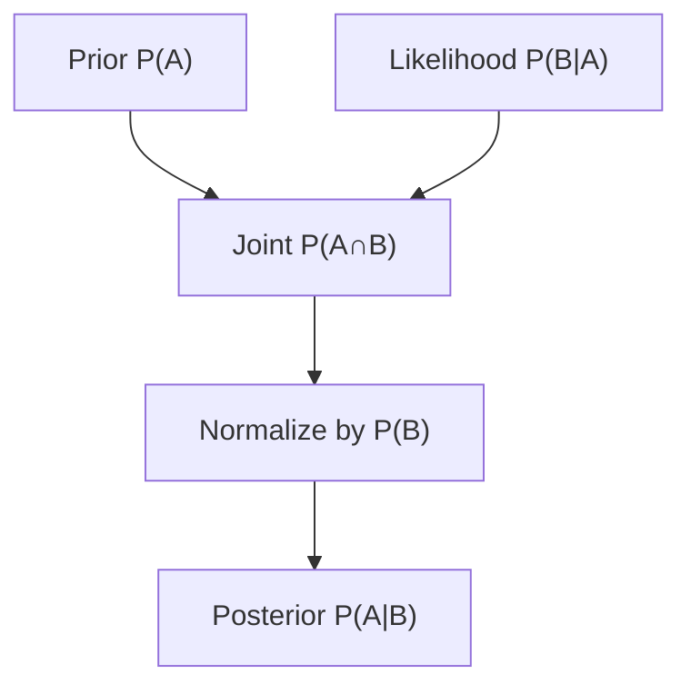
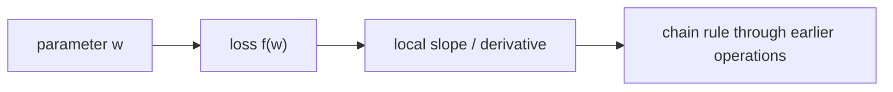
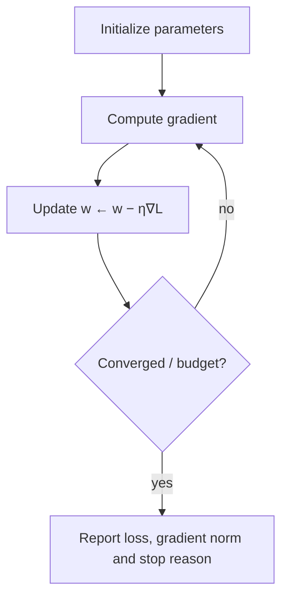
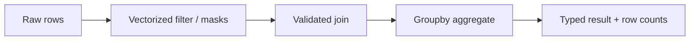
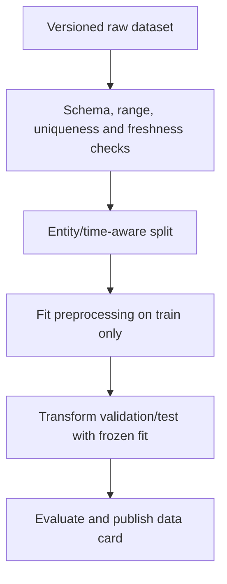

# Stage 01 — Mathematics, Python & Data Foundations

> **Mastery objective:** independently derive, implement, test and debug the mathematical and data transformations that sit underneath an ML training pipeline. Do not move to Stage 2 until the seven topic gates and integrated project pass.

## Learning contract

Every topic follows the same five-part loop: (1) explain the idea and its assumptions, (2) derive a small numerical example by hand, (3) implement it without hiding the important operation behind a library, (4) compare against a trusted implementation, and (5) inject a failure and prove the test catches it. The browser visualizers are teaching aids; the Python reference implementations and tests are the executable source of truth.

## Topic 1 — Vectors, matrices and tensor shapes

### Mental model and mathematics
A vector is an ordered coordinate list; a matrix is a linear transformation; a tensor is an array whose axes carry meanings such as batch, time, height, width and feature. Shape is a contract, not decoration. For A in R^(m×n) and X in R^(n×b), AX is in R^(m×b): the inner dimensions must agree and the outer dimensions survive.

Dot product: a·b = Σᵢ aᵢbᵢ. Matrix multiplication: Cᵢⱼ = Σₖ AᵢₖBₖⱼ. Transpose swaps axes; broadcasting aligns dimensions from the right and permits equal dimensions or a dimension of one. Broadcasting does not mean arbitrary shape compatibility.

### Worked calculation
A=[[1,2],[3,4]], x=[2,1]. Then Ax=[1·2+2·1, 3·2+4·1]=[4,10]. A²=[[7,10],[15,22]]. For a batch X with shape (2,3), A(2,2)X(2,3) has shape (2,3).

### Diagram

### Numerical animation storyboard
Frame 1 highlights row [1,2] and column [2,1]. Frame 2 shows products 2 and 2. Frame 3 accumulates 4. Frame 4 moves to row [3,4], accumulates 6+4=10. Frame 5 reveals output [4,10] and shape (2,1). The UI should advance one multiply-accumulate at a time and expose row/column indices.

### Implementation and comparison
Run `python examples/stage-01/foundations.py vectors`. Implement dot and matrix multiplication with explicit dimension checks; compare results with NumPy when installed. Record the meaning of each axis for batch, sequence and image tensors.

### Failure lab
Try a 2×3 matrix multiplied by a 2×2 matrix; expect a clear dimension error. Then test ragged rows, empty vectors and an accidental transpose. Explain why silently flattening or reshaping would conceal a modelling bug.

### Assessment gate
Pass when you can derive Ax by hand, predict shapes before running code, explain broadcasting with a concrete example, and pass both positive and incompatible-shape tests.

## Topic 2 — Probability and statistics

### Mental model and mathematics
Probability quantifies uncertainty under a defined sample space. Conditional probability updates the denominator to the event already observed: P(A|B)=P(A∩B)/P(B). Bayes' rule reverses conditioning: P(A|B)=P(B|A)P(A)/P(B). Expectation is a weighted average; variance measures squared spread; covariance measures joint movement. A sample statistic is uncertain and should be reported with sample size and an interval, not as an exact population fact.

### Worked calculation
Let P(A)=0.2, P(B|A)=0.8, P(B|¬A)=0.1. P(B)=0.8·0.2+0.1·0.8=0.24. Therefore P(A|B)=0.16/0.24=2/3≈0.667. A seemingly strong positive test can still have a meaningful false-positive contribution when the base rate is low.

### Diagram

### Numerical animation storyboard
Reveal 1000 synthetic cases: 200 positives in A, 160 observed B among A; 800 not-A, 80 observed B among not-A. Highlight 240 total B, then 160/240=0.667 posterior. A seeded simulation animates the counts without changing the theoretical answer.

### Implementation
Run `python examples/stage-01/foundations.py probability`. Use a fixed random seed, estimate a conditional probability, and compare with Bayes' rule. Report empirical estimate, theoretical value and trial count.

### Failure lab
Use a tiny sample, a rare event and a highly imbalanced label distribution. Show why an estimate can vary widely and why accuracy alone is misleading. Deliberately swap P(B|A) with P(A|B) and make the test fail.

### Assessment gate
Pass when you can derive the posterior, distinguish prior/likelihood/evidence/posterior, calculate mean/variance/covariance, and explain sampling error and correlation-versus-causation.

## Topic 3 — Derivatives and gradients

### Mental model and mathematics
A derivative is a local sensitivity: the slope of the tangent as the input changes. A partial derivative changes one coordinate while holding others fixed. The gradient collects partial derivatives. The chain rule composes sensitivities through nested functions. Finite differences approximate a derivative and are useful as an independent implementation check, but step size creates truncation and floating-point error.

### Worked calculation
For f(w)=(w−3)², f'(w)=2(w−3). At w=1, f'(1)=−4. Central difference [f(w+ε)−f(w−ε)]/(2ε) should approach −4 as ε shrinks within a numerically stable range.

### Diagram

### Numerical animation storyboard
Plot f(w)=(w−3)². Move a marker from w=1; draw a secant between w−ε and w+ε; shrink ε toward the tangent; display slope −4. A second coordinate view shows each partial derivative separately before combining them into a gradient vector.

### Implementation
Run `python examples/stage-01/foundations.py calculus`. Implement analytic and central-difference gradients for scalar and two-parameter functions; compare within a tolerance.

### Failure lab
Inject a reversed subtraction sign, choose ε too large, then choose ε near machine precision. Observe sign error and numerical instability. Test a non-differentiable point and state why a classical derivative may not exist.

### Assessment gate
Pass when analytic and numerical derivatives agree over several points, you can apply the chain rule to a two-layer scalar function, and you can explain why a gradient is not proof of a global optimum.

## Topic 4 — Optimization foundations

### Mental model and mathematics
Optimization adjusts parameters to minimize an objective. Batch gradient descent uses the full dataset per update; stochastic descent uses one example; mini-batch descent trades gradient noise against compute efficiency. Learning rate controls step size. Poor conditioning creates narrow valleys; saddle points have near-zero gradient without being minima. Convexity gives stronger global guarantees than general non-convex objectives.

### Worked calculation
For MSE L(w)=mean((wx−y)²), dL/dw=mean(2x(wx−y)). With x=[1,2,3], y=[2,4,6], w₀=0, the gradient is −2·mean(xy)=−(4+16+36)/3=−18.6667. A learning rate of 0.1 updates w to about 1.8667; the next loss is much smaller. A rate of 10 overshoots dramatically.

### Diagram

### Numerical animation storyboard
Animate three trajectories on a quadratic contour: tiny η crawls; suitable η approaches the minimum; excessive η jumps across the valley and diverges. Each frame displays w, loss, gradient norm and learning rate. Never hide non-finite values.

### Implementation
Run `python examples/stage-01/foundations.py optimization`. Train a one-weight linear model and log every update. Compare full-batch and mini-batch behaviour using a fixed seed.

### Failure lab
Run too-small, suitable and too-large learning rates; inject a sign error in the update; provide constant features; cap iterations. The run must terminate with an explicit reason and never claim convergence when loss is NaN or diverging.

### Assessment gate
Pass when loss decreases for a stable configuration, the oversized step is detected, the gradient formula is derived, and the run reports iteration count, gradient norm and stop reason.

## Topic 5 — Python for data work

### Mental model
Treat a data pipeline as a sequence of explicit boundaries: read bytes, parse records, validate schema, normalize values, deduplicate, transform, and report. Keep pure functions separate from filesystem I/O. Use type hints, dataclasses, pathlib, context managers, iterators/generators, exceptions, structured logging and deterministic tests. Fail with row-level context; do not silently discard malformed data.

### Implementation
Run `python examples/stage-01/foundations.py python-core --input examples/stage-01/fixtures/people.csv`. The CLI validates required columns, integer conversion and unique IDs, retains valid records and reports invalid rows with line numbers. It exits non-zero for a missing file or invalid schema.

### Failure lab
Test missing/empty file, malformed CSV quoting, Unicode, null fields, duplicate identifiers, wrong numeric types and unexpected columns. Ensure the error identifies the row and field without dumping sensitive raw records.

### Assessment gate
Pass when a clean environment can run the CLI, all invalid fixtures are handled deterministically, and transformations can be unit-tested without touching disk.

## Topic 6 — NumPy and Pandas

### Mental model
Vectorization moves repeated element-wise work into optimized array operations. NumPy broadcasting follows shape rules; Pandas adds labelled axes, missing values, joins and groupby operations. Labels are powerful but can silently align data by index. A many-to-many join can multiply rows. Null propagation and dtype coercion must be intentional.

### Worked calculation
Given team=[A,A,B], score=[10,20,5], active=[1,0,1], filter active rows then group by team: A→10, B→5. The inactive A row is excluded. A duplicate join key can multiply matching records and inflate an aggregate.

### Diagram

### Numerical animation storyboard
Show three rows; animate boolean mask [true,false,true]; fade excluded row; group surviving rows by team; accumulate sums; reveal A=10 and B=5. A second animation duplicates a join key and shows row count expanding from 3 to 4, then triggers a cardinality warning.

### Implementation
Run `python examples/stage-01/foundations.py numpy-pandas`. If NumPy and Pandas are installed, compare vectorized calculations with a plain Python reference. The core suite remains runnable without optional libraries.

### Failure lab
Test null scores, duplicate indexes, duplicate join keys, timezone-aware timestamps, mixed numeric strings and index misalignment. Assert expected row counts before and after joins.

### Assessment gate
Pass when vectorized and reference results agree, join cardinality is checked, missing-value policy is explicit, and memory/row-count effects are recorded.

## Topic 7 — Data quality and leakage

### Mental model
Data quality checks schema, completeness, ranges, uniqueness, consistency and freshness. Leakage occurs when training uses information unavailable at prediction time: future events, target-derived columns, entity duplicates across splits, or preprocessing fitted on validation/test data. Split first; fit transformations only on training data; apply the fitted transformation to held-out data.

### Worked calculation
Train values [0,2,4] have mean 2. If validation value 1000 is included before fitting, the combined mean becomes 251.5. That changes the transformation using information that should have remained unseen. The validation sample must not influence fitted preprocessing parameters.

### Diagram

### Numerical animation storyboard
Frame 1 shows train [0,2,4] and validation [1000]. Frame 2 fits train-only mean=2. Frame 3 reveals global mean=251.5 as the deliberately leaky alternative. Frame 4 compares transformed values and flags the validation-to-fit dependency in red. The animation explains the mechanism; tests enforce it.

### Implementation
Run `python examples/stage-01/foundations.py data-quality`. Validate schema/ranges/uniqueness, split by entity and time, fit preprocessing on train only, and emit a data-quality report with row counts and rejected records.

### Failure lab
Inject a future timestamp, target-derived feature, duplicate entity across splits, globally fitted scaler and a post-outcome column. Each injected leak must fail a named test.

### Assessment gate
Pass when no entity crosses a split, temporal ordering is preserved, validation/test data never calls fit, and a data card documents provenance, intended use, limitations and known risks.

## Stage 1 integrated project — Reproducible tabular ML pipeline

Build ingestion → schema validation → cleaning → feature generation → entity/time-aware split → train-only preprocessing → artifact export → data card. Include at least 10 automated tests, one intentionally failing leakage fixture, a data-flow diagram, tensor-shape table, deterministic run command and a short incident report explaining one fixed failure.

## Stage 1 mastery gate

All seven topic gates must pass. Minimum evidence:
- Correct numerical derivations for matrix multiplication, Bayes' rule, gradients and one optimization update.
- Executable reference implementations and passing tests, including negative cases.
- One numerical animation/trace per math topic, with inspectable intermediate values.
- A reproducible Python data pipeline and optional NumPy/Pandas comparison.
- Explicit data-quality and leakage tests, plus a completed data card.

## References
- Python tutorial: https://docs.python.org/3/tutorial/
- NumPy quickstart: https://numpy.org/doc/stable/user/quickstart.html
- pandas getting started: https://pandas.pydata.org/docs/getting_started/index.html
- SciPy optimization: https://docs.scipy.org/doc/scipy/tutorial/optimize.html
- scikit-learn common pitfalls: https://scikit-learn.org/stable/common_pitfalls.html
