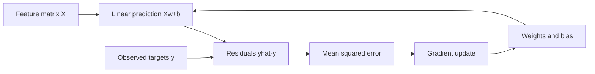
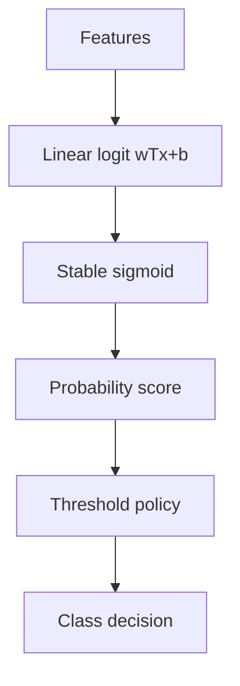
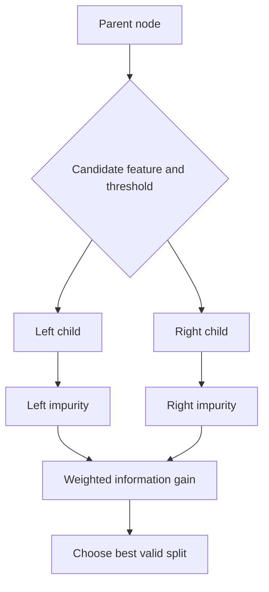
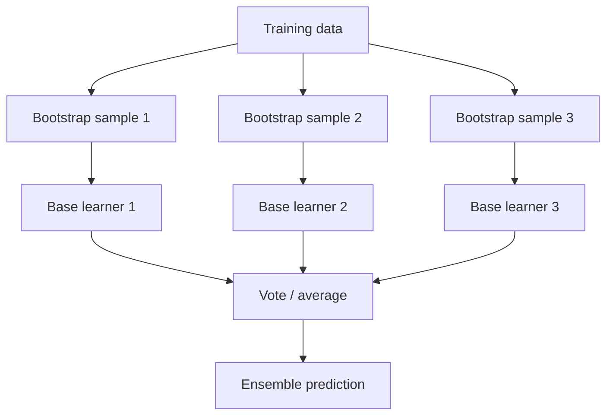
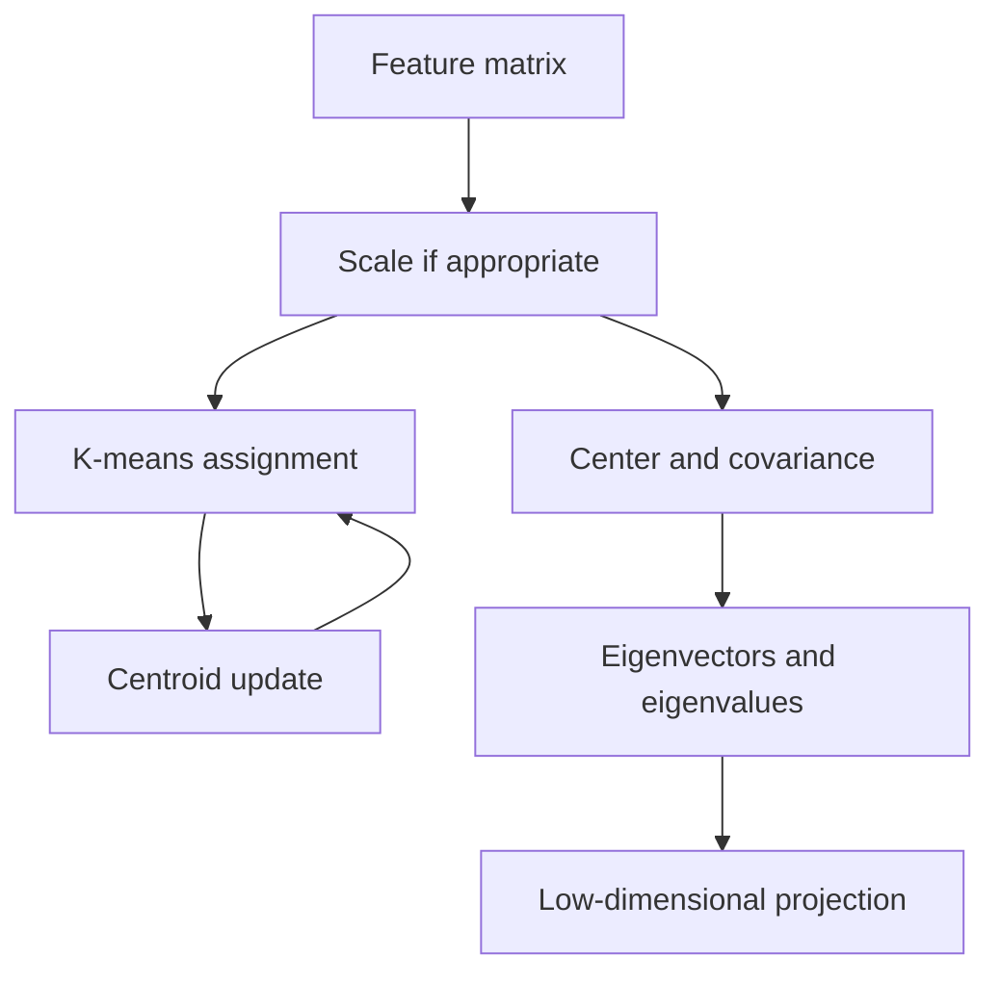
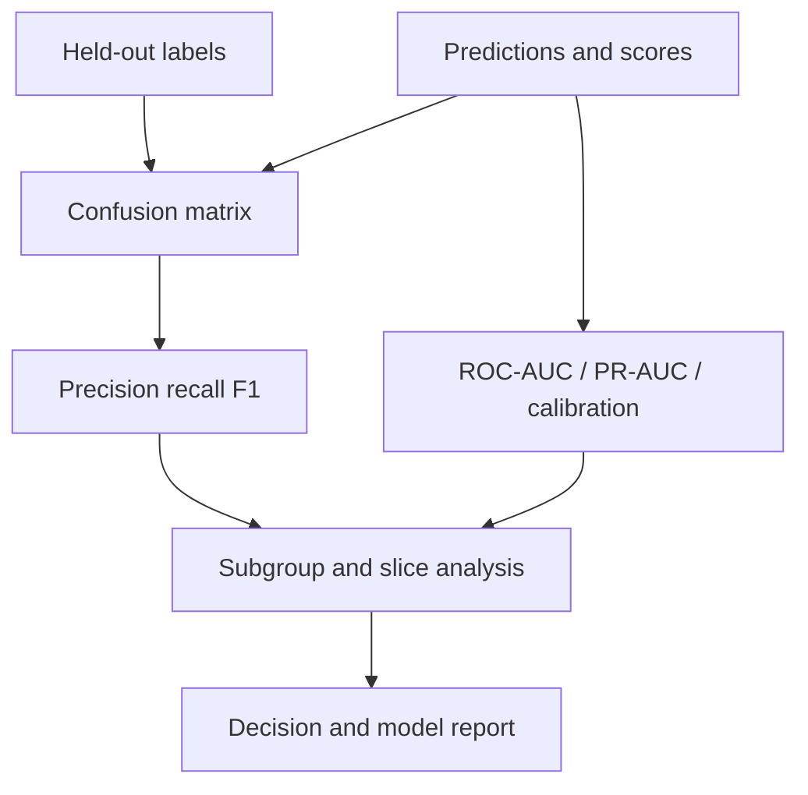

# Stage 02 — Classical Machine Learning

> **Mastery objective:** choose, derive, implement and evaluate classical models without confusing a metric with a deployment decision. Every experiment must split before fitting preprocessing and report its assumptions.

## Learning contract

For each topic: state the prediction task; derive the objective or decision rule; calculate a tiny example by hand; implement the core operation; compare against a trusted library where available; inject a failure; and submit code/test evidence. A high training score is not a mastery result.

## Topic 1 — Linear regression

### Mental model and objective
Linear regression estimates a continuous target with a linear combination of features: ŷ = Xw + b. The ordinary least-squares objective is MSE = (1/n)Σ(ŷᵢ−yᵢ)². For a single feature, the slope is covariance(x,y)/variance(x), and b = mean(y)−w·mean(x). Gradient descent uses ∂MSE/∂wⱼ = (2/n)Σxᵢⱼ(ŷᵢ−yᵢ), with the matching intercept gradient.

### Worked calculation
For x=[1,2,3] and y=[3,5,7], the exact line is w=2,b=1. Predictions are [3,5,7], residuals [0,0,0], and MSE=0. If the final target changes from 7 to 8, the third residual becomes −1 and MSE becomes 1/3 for the unchanged line.

### Diagram

### Numerical animation storyboard
Move the slope and intercept controls. For each point, draw the predicted value, residual segment and squared residual. Reveal the mean only after all points are accumulated. A second view shows one gradient step and the new line.

### Implementation and comparison
Use the dependency-free reference in examples/stage-02/classical_ml.py and its tests. Compare the one-feature result with a NumPy least-squares or scikit-learn LinearRegression result when installed. Keep the feature matrix shape (n_samples,n_features).

### Failure lab
Inject a constant feature, collinear columns, a large outlier and a target with zero variance. Explain when the normal equation is ill-conditioned and why QR/SVD is safer than explicitly computing an inverse.

### Assessment gate
Derive the MSE gradient; reproduce the [3,5,7] exact fit; compare closed form and gradient descent; explain residual patterns, collinearity, outlier sensitivity and extrapolation risk.

## Topic 2 — Logistic regression and classification

### Mental model and objective
Logistic regression models a logit z=wᵀx+b and probability p=σ(z)=1/(1+e⁻ᶻ). Binary cross-entropy is −(1/n)Σ[y log p+(1−y)log(1−p)]. Its gradient is (1/n)Xᵀ(p−y). The threshold converts a probability score into an action; it is a decision policy, not the probability model itself.

### Worked calculation
For logits [−2,0,2], sigmoid probabilities are approximately [0.119,0.5,0.881]. At threshold 0.5, predictions are [0,1,1]. At threshold 0.8, they become [0,0,1]. The threshold change can trade false positives for false negatives without changing the fitted model.

### Diagram

### Numerical animation storyboard
Move the logit from −6 to +6 and watch sigmoid move from near zero through 0.5 toward one. Freeze the score and move the threshold independently; show which class decision changes and why.

### Implementation
Implement a numerically stable sigmoid, clipped binary cross-entropy and the (p−y) gradient. Compare probabilities, log loss and thresholded decisions with scikit-learn on a controlled split.

### Failure lab
Test extreme logits, all-one/all-zero labels, severe class imbalance, threshold 0.2 versus 0.8 and a miscalibrated probability output. Never interpret high accuracy as sufficient evidence on a rare-positive task.

### Assessment gate
Derive the log-loss gradient; calculate the three sigmoid values; explain threshold versus calibration; report class-wise precision/recall and justify the error-cost trade-off.

## Topic 3 — Decision trees and split selection

### Mental model and objective
A classification tree recursively partitions feature space. Gini impurity is 1−Σₖpₖ²; entropy is −Σₖpₖlog₂pₖ. Split gain is parent impurity minus the child-size-weighted impurity. Greedy local gain does not guarantee a globally optimal tree.

### Worked calculation
Parent labels [0,0,1,1] have Gini=0.5. A split into [0,0] and [1,1] has weighted child Gini=0, so gain=0.5. A split with mixed children has lower gain.

### Diagram

### Numerical animation storyboard
Slide the threshold across six labelled points. Recompute left/right counts, Gini and weighted gain on every movement. Highlight the maximum-gain threshold and show what happens when a child becomes empty.

### Implementation
Use gini, entropy and information_gain in the Stage 2 reference implementation. Build one greedy split for the fixture and compare with a shallow DecisionTreeClassifier.

### Failure lab
Try a noisy split, an empty child, a deep tree on a tiny dataset and a high-cardinality identifier feature. Compare train/validation error and explain why impurity-based feature importance can be biased.

### Assessment gate
Calculate parent/child impurity; select a split; explain max_depth, min_samples_leaf and pruning; identify overfit and biased importance risks.

## Topic 4 — Ensembles: bagging, random forests and boosting

### Mental model and objective
Bagging trains base estimators on bootstrap samples and aggregates predictions; it primarily reduces variance. Random forests add random feature subsets to decorrelate trees. Boosting adds learners sequentially to correct residual/error patterns; learning rate and tree depth control the contribution and complexity.

### Worked calculation
Five binary base learners predict [1,1,0,1,0]. Majority vote is class 1 (three of five). A tie policy must be explicit for an even number of voters. The ensemble does not become correct merely because it contains more models.

### Diagram

### Numerical animation storyboard
Reveal bootstrap samples with replacement, train separate shallow trees and tally votes. Then contrast boosting: add one learner, inspect remaining errors, add the next learner and show shrinkage of each learner's contribution.

### Implementation
Use majority_vote in the dependency-free reference; build bootstrap samples with a fixed seed. Compare a single tree, random forest and gradient boosting with identical folds and a fixed metric set.

### Failure lab
Use identical base learners, a noisy target, excessive boosting depth and a learning rate that is too large. Explain correlation between base learners, out-of-bag estimates and why feature importance is not causal evidence.

### Assessment gate
Explain variance reduction versus sequential error correction; calculate a vote; demonstrate seed reproducibility; compare validation performance and model complexity.

## Topic 5 — KNN and support vector machines

### Mental model and objective
KNN predicts from the labels of the k closest training examples. Euclidean distance is √Σⱼ(xⱼ−qⱼ)²; scaling matters because feature units affect distance. A linear SVM finds a separating hyperplane with a large margin; hinge loss is max(0,1−y(wᵀx+b)). Kernel methods represent nonlinear boundaries through similarity functions.

### Worked calculation
Points (0,0):A, (0,2):A and (3,3):B with query (1,1) have distances √2, √2 and √8. For k=3, the vote is A. A tie rule and deterministic distance ordering must be documented.

### Diagram

### Numerical animation storyboard
Move the query point and watch distances reorder. Change k and show the vote. A separate margin view moves the SVM hyperplane and highlights support vectors and the margin band.

### Implementation
Implement KNN distance ranking and test ties/k bounds. Fit linear and RBF SVM after training-only scaling; record support-vector count and margin behavior.

### Failure lab
Compare unscaled and standardized features, test k larger than the sample count, tied distances, high-dimensional concentration and outliers. Compare KNN's inference cost with a fitted linear model.

### Assessment gate
Calculate sorted distances and a vote; explain scaling; derive hinge loss; identify support vectors and discuss latency/memory trade-offs.

## Topic 6 — Clustering and dimensionality reduction

### Mental model and objective
K-means alternates assignment to the nearest centroid and centroid recomputation, minimizing within-cluster squared distance. DBSCAN uses density reachability and can label noise. PCA centers features and finds eigenvectors of the covariance matrix; explained variance ratio is λᵢ/Σλ. Clusters are hypotheses, not known labels.

### Worked calculation
Points [1,1],[1,2],[8,8],[9,8] with centers [1,1],[8,8] assign [0,0,1,1]. Updated centers are [1,1.5] and [8.5,8]. For PCA, center each feature before covariance and projection.

### Diagram

### Numerical animation storyboard
Animate point-to-centroid assignments, then move each centroid to the mean of its assigned points. For PCA, rotate the projection axis and show projected variance; highlight the first principal direction.

### Implementation
Use kmeans_step and pca_2d references. Compare K-means with DBSCAN and a trusted PCA implementation; fit all preprocessing and PCA only on each training fold.

### Failure lab
Test empty clusters, poor initialization, non-spherical clusters, density variation, outliers, constant columns and unscaled features. Explain why PCA preserves variance, not necessarily class separation.

### Assessment gate
Reproduce one centroid update; calculate covariance for a tiny 2D dataset; interpret explained variance; explain when density-based clustering or PCA is inappropriate.

## Topic 7 — Model evaluation and error analysis

### Mental model and metrics
Confusion counts are TP, FP, FN and TN. Precision=TP/(TP+FP), recall=TP/(TP+FN), F1=2PR/(P+R), accuracy=(TP+TN)/N. ROC-AUC measures ranking across false-positive rates; PR-AUC emphasizes positive-class precision/recall. MAE, RMSE and R² suit regression. Calibration asks whether predicted probabilities match observed frequencies. Macro, micro and weighted averages answer different aggregation questions.

### Worked calculation
TP=8, FP=2, FN=4, TN=16 gives precision=0.8, recall=8/12≈0.667, F1≈0.727 and accuracy=24/30=0.8. On a rare-positive dataset, accuracy can remain high while recall is unacceptable.

### Diagram

### Numerical animation storyboard
Change TP/FP/FN/TN sliders and update precision, recall, F1 and accuracy. Move the classification threshold and display the trade-off curve. Highlight why one scalar metric cannot encode business costs or fairness constraints.

### Implementation
Use confusion_metrics and roc_auc reference functions. Add threshold sweeps, per-class metrics and subgroup slices; compare results with scikit-learn.

### Failure lab
Test no predicted positives, no actual positives, rare positives, a subgroup with poor recall and a model with good AUC but poor calibration. Never tune on the final test set.

### Assessment gate
Calculate metrics by hand; explain ROC-AUC versus PR-AUC; distinguish ranking from calibration; define metrics and slices before model training.

## Stage 2 integrated project — Reproducible model comparison

Run:
`python examples/stage-02/model_comparison.py --input examples/stage-02/fixtures/student-outcomes.csv --output build/stage-02/model-comparison.json --folds 3`

Run tests:
`python -m unittest discover -s examples/stage-02 -p 'test_*.py' -v`

The reference compares logistic regression, KNN and a bagged decision-stump ensemble with deterministic stratified folds. It fits the scaler inside each training fold, exports fold audits and reports precision, recall, F1 and accuracy. Review MODEL_DATA_CARD.md, MODEL_DFD.md and incident-report.md. This tiny synthetic dataset is a teaching fixture, not evidence of real-world model quality.

## Stage 2 mastery gate

Pass all seven topic assessments, reproduce the numerical fixtures, implement and test the central algorithm for each family, diagnose at least one failure per family, and complete the model-comparison report. Stage 3 begins only after the seven gates and integrated project are validated.

## Primary references
- scikit-learn user guide: https://scikit-learn.org/stable/user_guide.html
- Model evaluation: https://scikit-learn.org/stable/modules/model_evaluation.html
- Preprocessing and leakage pitfalls: https://scikit-learn.org/stable/common_pitfalls.html
- Ensemble methods: https://scikit-learn.org/stable/modules/ensemble.html
