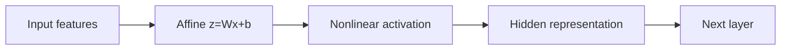
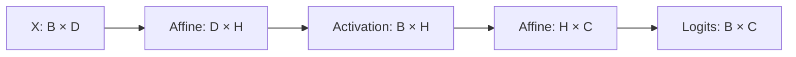
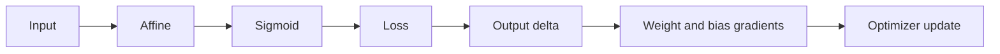
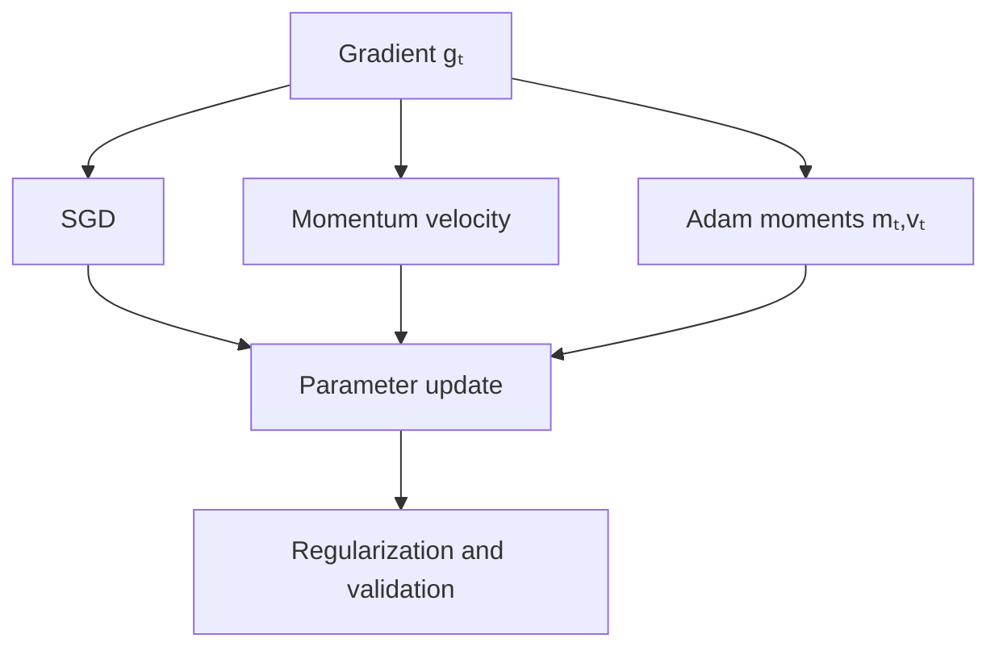
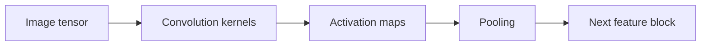
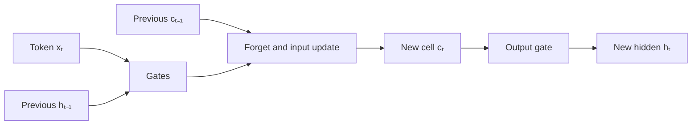
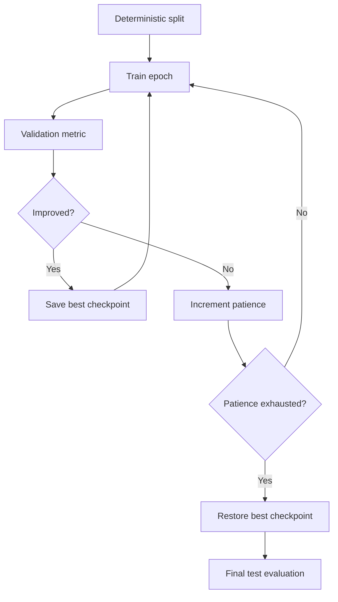

# Stage 03 — Deep Learning

> **Mastery objective:** reason about neural networks as differentiable programs. Predict tensor shapes, derive gradients, verify them numerically, compare optimization and regularization choices, and produce a reproducible checkpointed model.

## Learning contract
Every topic requires a derivation, a hand-worked numerical trace, a runnable implementation, a negative test and an explanation of the limitation. Visualizations are deterministic teaching fixtures; the Python reference suite is the executable numerical source of truth.

## Topic 1 — Perceptrons, activations and multilayer networks
A neuron computes z=wᵀx+b followed by an activation. ReLU=max(0,z), sigmoid=1/(1+e⁻ᶻ), tanh=(eᶻ−e⁻ᶻ)/(eᶻ+e⁻ᶻ). Stacking affine layers without a nonlinear activation remains one affine transformation; depth alone does not create nonlinear capacity.

**Worked example:** for x=[1,0], w=[2,−1], b=−0.5, z=1.5. Sigmoid(z)≈0.818; ReLU(z)=1.5. The activations have different ranges and gradient behavior.

**Diagram**

**Animation storyboard:** move x₁/x₂ and weights independently; display each multiply, bias addition, pre-activation and activation output. Toggle activation off to demonstrate a collapsed linear stack; test XOR points.
**Implementation:** use sigmoid, relu and forward_2_2_1 in examples/stage-03/deep_learning.py.
**Failure lab:** saturate sigmoid, remove nonlinearities, inject a shape mismatch and test non-finite inputs.
**Mastery gate:** derive z and activation, explain why XOR needs nonlinearity, and compare activation saturation and gradient flow.

## Topic 2 — Forward propagation and tensor contracts
A batch X with shape (B,D) multiplied by W with shape (D,H) yields (B,H). Bias broadcasts across B; the next layer repeats the contract. The batch axis, feature axis, channel axis and sequence axis must have explicit meanings.

**Worked example:** X=(2×3), W₁=(3×4), b₁=(4), W₂=(4×2) produces hidden=(2×4) and logits=(2×2).
**Diagram**

**Animation storyboard:** step through batch rows, multiply one input vector by each weight column, add bias, apply activation and reveal final logits.
**Implementation:** forward_2_2_1 exposes hidden activations, logit and output.
**Failure lab:** batch size one, wrong feature width, transposed weights, dtype/device mismatch and NaN/Inf.
**Mastery gate:** predict shapes before execution and trace all intermediate tensors.

## Topic 3 — Loss, backpropagation and gradient checks
For a sigmoid output with half squared error, L=½(ŷ−y)², the output delta is (ŷ−y)σ′(z). For one input, ∂L/∂w=(ŷ−y)σ′(z)x and ∂L/∂b=(ŷ−y)σ′(z). In multilayer networks, multiply by downstream weights and each activation derivative while moving backward.

**Worked example:** x=0.8,w=0.4,b=0.1,y=1 gives z=0.42 and ŷ≈0.603. The gradient is negative, so a small positive weight update should increase the output toward the target.
**Diagram**

**Animation storyboard:** highlight the forward graph, then reverse arrows and display each local derivative and accumulated gradient. Compare analytic gradient with a central finite difference.
**Implementation:** neuron_loss_gradient and finite_difference in deep_learning.py, plus mlp_forward and mlp_binary_loss_gradients in advanced_deep_learning.py. The MLP reference returns every layer's gradients and is checked parameter-by-parameter against central differences.
**Failure lab:** reverse subtraction, omit batch averaging, transpose a gradient, use epsilon too large/small and inspect vanishing/exploding signals.
**Mastery gate:** derive the chain rule, match numerical gradients within tolerance and diagnose one deliberately corrupted gradient.

## Topic 4 — Optimizers, schedules and regularization
SGD uses θ←θ−ηg. Momentum accumulates velocity; Adam tracks first and second gradient moments with bias correction. AdamW decouples weight decay from adaptive gradient updates. L1 encourages sparsity; L2 penalizes squared weights; dropout randomly removes activations during training and is disabled/scaled appropriately at inference. Batch normalization uses batch statistics during training and running statistics for inference.

**Worked example:** with θ=1,g=0.5,η=0.1, one SGD step gives θ=0.95. Momentum and Adam produce different updates because they retain state.
**Diagram**

**Animation storyboard:** run SGD, momentum and Adam on the same quadratic from the same initial value. Show parameter, loss, gradient norm and optimizer state. Toggle dropout train/eval and vary L2.
**Implementation:** optimizer_step, dropout and batch_norm in deep_learning.py, plus regularization_penalty in advanced_deep_learning.py. The training project uses momentum SGD and persists velocity state.
**Failure lab:** excessive learning rate, stale optimizer state after resume, dropout left enabled at inference and weight decay confused with L2.
**Mastery gate:** explain optimizer state, compare convergence, and distinguish regularization mechanisms.

## Topic 5 — Convolutional neural networks
A convolution applies a shared kernel across spatial locations. For valid padding, output height is floor((H−K+2P)/S)+1; channels and kernel count determine parameter count. Receptive field grows with stacked kernels and stride. Pooling reduces spatial dimensions.

**Worked example:** input [[1,2,3],[4,5,6],[7,8,9]] and a 2×2 all-ones kernel produce [[12,16],[24,28]] with stride 1 and valid padding.
**Diagram**

**Animation storyboard:** slide a kernel cell by cell, highlight multiplied pixels, accumulate the output map and apply max pooling.
**Implementation:** conv2d_valid and max_pool2d.
**Failure lab:** off-by-one dimensions, stride/padding mismatch, channel order mismatch and oversized kernel.
**Mastery gate:** calculate output dimensions and one output value; explain channels, weight sharing and receptive field.

## Topic 6 — RNNs, LSTMs and sequence models
A vanilla recurrent unit computes hₜ=tanh(Wₓxₜ+Wₕhₜ₋₁+b). Backpropagation through time repeatedly multiplies Jacobians; long sequences can cause vanishing or exploding gradients. LSTM gates regulate cell memory: forget fₜ, input iₜ, candidate gₜ, cell cₜ=fₜ⊙cₜ₋₁+iₜ⊙gₜ and output hₜ=oₜ⊙tanh(cₜ).

**Worked example:** hₜ=tanh(xₜ+0.5hₜ₋₁), x=[1,0,−1], h₀=0 yields a deterministic three-step state trace.
**Diagram**

**Animation storyboard:** advance token by token, preserve hidden/cell state, then reset state and reverse input order to show why sequence order matters.
**Implementation:** rnn_sequence and lstm_step in deep_learning.py, plus rnn_bptt_gradients in advanced_deep_learning.py. Verify recurrent-weight and input-weight gradients against finite differences.
**Failure lab:** shuffled order, missing padding mask, state reused across independent samples and long-sequence instability.
**Mastery gate:** calculate recurrent state and gates, explain BPTT and state-reset boundaries.

## Topic 7 — Generalization, checkpoints and training systems
Training loss measures fit to training data; validation loss estimates generalization under the validation distribution. Underfitting has both losses high; overfitting often has training loss falling while validation loss worsens. Early stopping records the best validation checkpoint. A resumable checkpoint should include model parameters, optimizer moments, scheduler state, epoch, random generator state and data-loader position.

**Worked example:** validation losses [0.9,0.7,0.5,0.55,0.6] with patience 2 select epoch 3 and stop at epoch 5.
**Diagram**

**Animation storyboard:** compare train and validation curves, highlight the best epoch, count patience and restore the best model rather than the final epoch.
**Implementation:** early_stopping, generalization_gap and the checkpointable training project.
**Failure lab:** validation leakage, test-set tuning, missing optimizer state, nondeterministic resume and under/over-regularization.
**Mastery gate:** diagnose curves, reproduce a checkpointed run and report held-out per-class metrics.

## Stage 3 integrated project — Train and package a neural classifier

Run:
`python examples/stage-03/training_project.py --checkpoint build/stage-03/mlp-checkpoint.json --epochs 250`

Resume:
`python examples/stage-03/training_project.py --checkpoint build/stage-03/mlp-checkpoint.json --epochs 300 --resume`

Tests:
`python -m unittest discover -s examples/stage-03 -p 'test_*.py' -v`

The project trains a deterministic two-hidden-unit neural classifier with momentum SGD, separate train/validation/test partitions and early stopping. Checkpoints persist model parameters, momentum velocities, scheduler state, deterministic RNG metadata, epoch and data position; resume tests verify those fields. The report includes held-out metrics and best epoch. Review PROJECT_DATA_CARD.md, PROJECT_DFD.md, MODEL_CARD.md and incident-report.md. The synthetic dataset is educational only.

## Stage 3 mastery gate
Pass all seven evidence checklists, match analytic and finite-difference gradients, reproduce convolution and recurrent traces, compare optimizer behavior, diagnose generalization and complete checkpoint/resume tests. Stage 4 remains blocked until the full stage is validated.

## Primary references
- PyTorch tutorials: https://pytorch.org/tutorials/
- Autograd: https://pytorch.org/tutorials/beginner/basics/autogradqs_tutorial.html
- Reproducibility: https://pytorch.org/docs/stable/notes/randomness.html
- Convolution reference: https://pytorch.org/docs/stable/generated/torch.nn.Conv2d.html
