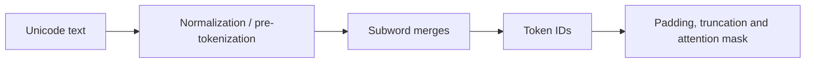
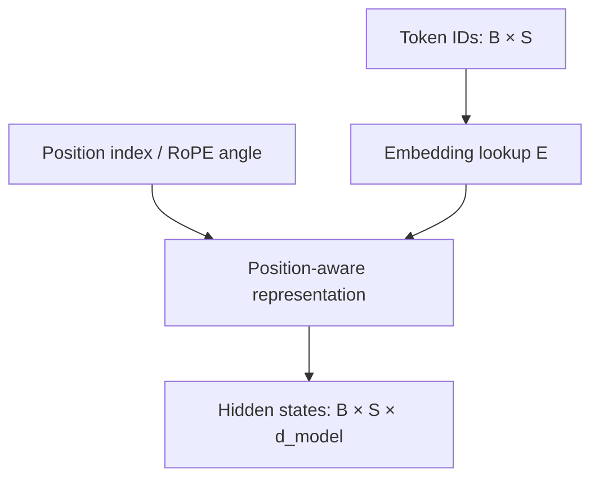
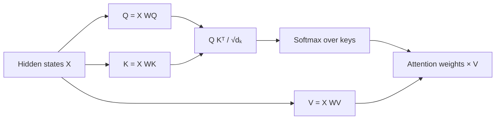
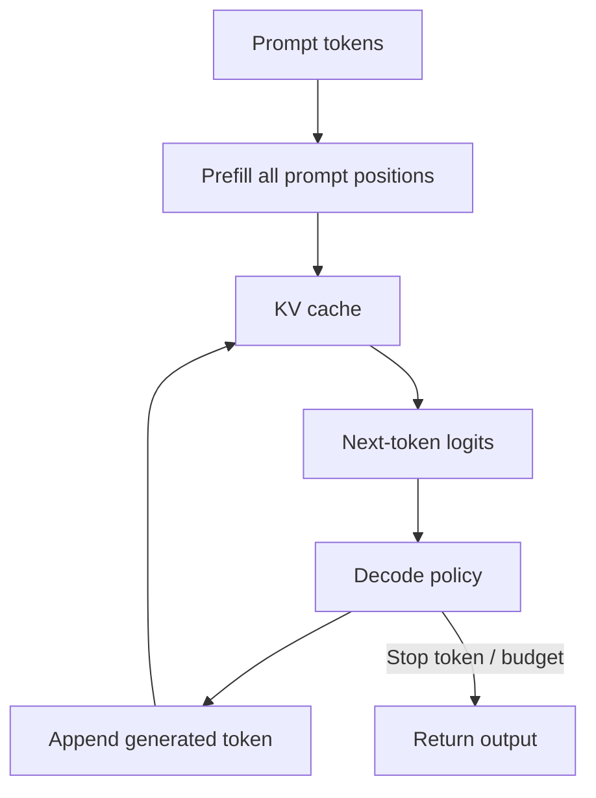
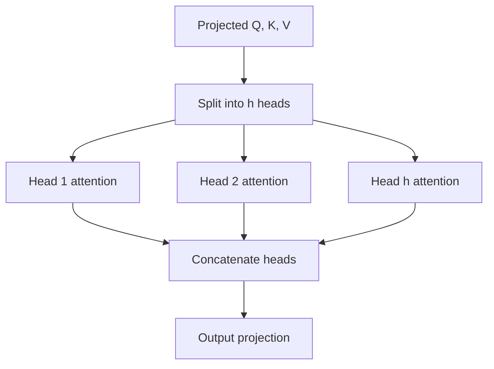
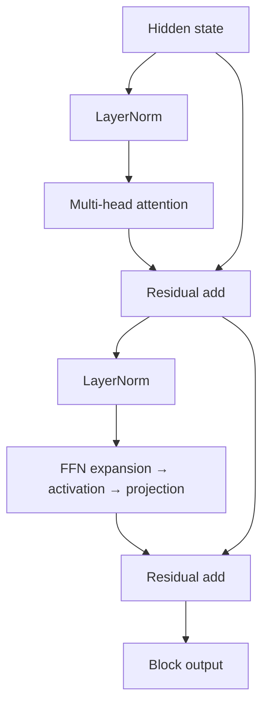
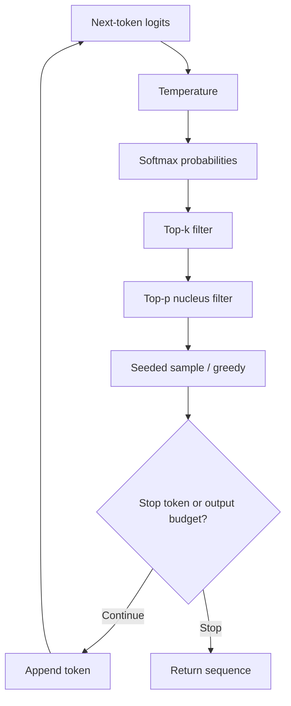
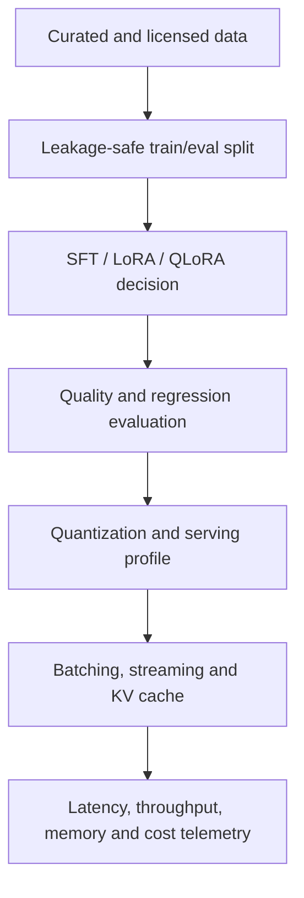

# Stage 04 — Transformers, LLMs & Generative AI

> **Mastery objective:** explain and implement the token-to-token computation of a decoder-only language model. Predict every tensor shape, calculate attention by hand, prevent future-token leakage, trace a transformer block, implement autoregressive generation and estimate inference/adaptation costs.

## Learning contract

For each of the eight topics: explain the concept and assumptions, derive a numerical example, implement the core operation, compare against a trusted framework when available, inject a failure and retain a regression test. The repository examples are deterministic, small educational references—not a trained foundation model. No large model download or paid compute is required.

## Topic 1 — Tokenization, vocabulary and context limits

A tokenizer maps a Unicode string into discrete token IDs. Word boundaries and token boundaries are different: byte-level BPE, WordPiece and Unigram methods represent frequent subword pieces and can split rare words, punctuation and multilingual text. Special IDs such as BOS, EOS, PAD and UNK have model-specific semantics. Truncation, padding and attention masks must be applied consistently.

A BPE training step starts with an initial symbol sequence, counts adjacent pairs, merges the most frequent pair and repeats. Inference applies the learned merge ranks in order. Tokenizer files and model embedding vocabulary must be versioned together.

**Worked calculation:** with initial symbols `l o w` and merges `(l,o)` then `(lo,w)`, the final token is `low`. A whitespace tokenizer would count one word too, but it cannot reproduce subword IDs for rare or multilingual text.

**Diagram**

**Numerical animation storyboard:** reveal a string as Unicode code points, display the current adjacent-pair merge ranks, merge one pair per frame, then show final IDs and the context-budget meter. Toggle whitespace tokenization to expose why word count is not token count.

**Implementation:** `tokenize_greedy` in transformers.py and ordered pair merging in `tokenize_bpe` in advanced_transformers.py.

**Failure lab:** test Unicode combining marks, emoji, punctuation, empty text, unknown subword, special-token collision, truncation boundary and tokenizer/model vocabulary mismatch. Reject a negative or zero token budget.

**Assessment gate:** explain BPE merge order, special tokens, vocabulary versioning and why context limits are measured in tokens rather than words.

## Topic 2 — Embeddings, positional information and RoPE

An embedding table (E\in\mathbb{R}^{V\times d_{model}}) maps each token ID to a learned vector. For a sequence of length (S), the lookup result has shape ((B,S,d_{model})). Absolute positional embeddings add a position vector to each token vector. Rotary positional embeddings (RoPE) rotate query/key coordinate pairs by position-dependent angles, allowing relative position information to appear in attention dot products.

**Worked calculation:** token ID 5 retrieves the same row (E_5=[0.2,0.1,0.4]) wherever it appears. At position 2, an absolute position vector ([0.04,0.08,-0.02]) produces ([0.24,0.18,0.38]). The lookup itself did not change; position altered the combined representation.

For a 2D RoPE pair ([1,0]) at angle \(\theta\), the rotated pair is ([\cos\theta,\sin\theta]); its Euclidean norm is preserved.

**Diagram**

**Numerical animation storyboard:** select one token ID and move it across positions. Keep the embedding row fixed, update the positional vector or RoPE angle, and show the resulting coordinates and preserved pair norm.

**Implementation:** `embedding_lookup` and `apply_rope`; inspect padding IDs and vector dimensions.

**Failure lab:** out-of-vocabulary ID, position vector width mismatch, odd RoPE hidden width, position overflow, mismatched tokenizer vocabulary and padding treated as a real token.

**Assessment gate:** predict ((B,S,d)), distinguish token and position representations, calculate one embedding sum and explain how RoPE changes Q/K geometry.

## Topic 3 — Q, K and V: scaled dot-product self-attention

Given hidden states (X\in\mathbb{R}^{B\times S\times d_{model}}), learned projections produce (Q=XW_Q), (K=XW_K), and (V=XW_V). Attention scores are (QK^T/\sqrt{d_k}); softmax is applied over the key dimension; the resulting weights multiply V. The scaling term limits score magnitude as key dimension grows.

**Worked calculation:** use (Q=K=I_2) and (V=[[1,0],[0,2]]). For the first query, scores are ([1/\sqrt2,0]), weights are approximately ([0.67,0.33]), and the output is approximately ([0.67,0.66]). The weights sum to one.

**Diagram**

**Numerical animation storyboard:** calculate one query/key dot product at a time, divide scores by \(\sqrt{d_k}\), stabilize and normalize softmax, then animate each weighted V contribution into the output vector.

**Implementation:** `scaled_dot_product_attention` in transformers.py. The full-sequence attention implementation in advanced_transformers.py reuses the same score/softmax/value calculation per query and head.

**Failure lab:** omit the scale, apply softmax on the wrong axis, use unstable exponentials, mismatch Q/K dimensions, pass an all-masked row or multiply weights by K instead of V.

**Assessment gate:** derive the attention equation, reproduce the two-token output, state the score/weight/output shapes and explain the quadratic (O(S^2d)) sequence interaction cost.

## Topic 4 — Causal masking, decoder-only training and KV cache

A decoder-only language model predicts the next token from the prefix. The causal mask permits position (i) to attend only to keys (j\le i). Training inputs and targets are shifted: ([t_0,t_1,t_2]\rightarrow([t_0,t_1],[t_1,t_2])). Padding masks and causal masks serve different purposes and must be combined with correct polarity.

During inference, prefill processes the prompt; decode generates one token at a time. A KV cache stores previous keys and values so each new token need not recompute the entire prefix.

**Worked calculation:** for sequence length 3, the causal visibility matrix is ([[1,0,0],[1,1,0],[1,1,1]]). At position 1 (zero-based), future position 2 must have exactly zero normalized attention weight.

KV-cache memory is approximately (2\times L\times S\times n_{kv}\times d_{head}\times bytes\times batch). With 32 layers, 2048 cached tokens, 8 KV heads, head dimension 128 and 2-byte values, one sequence needs about 256 MiB for K/V alone.

**Diagram**

**Numerical animation storyboard:** reveal a 3×3 lower-triangular mask; click each query position and show future keys disappearing before softmax. Then append a generated token and show the cache length increase by one.

**Implementation:** `causal_mask`, `shifted_lm_examples`, `kv_cache_bytes` and `generate_autoregressive`.

**Failure lab:** invert mask polarity, allow future tokens, shift labels in the wrong direction, reuse cache after changing model weights, exceed context length or omit EOS/max-token stopping.

**Assessment gate:** construct a causal mask, verify shifted targets, explain prefill versus decode and estimate KV cache bytes from dimensions.

## Topic 5 — Multi-head attention and projection shapes

Multi-head attention projects Q/K/V, divides the hidden dimension into heads, applies attention independently per head, concatenates head outputs and applies an output projection. For (d_{model}=8) and (h=2), each head has (d_k=4). The hidden width must be divisible by the head count. Different heads can learn different relationships; heads are not guaranteed to specialize.

**Worked calculation:** split ([1,2,3,4,5,6,7,8]) into two four-dimensional heads: ([1,2,3,4]) and ([5,6,7,8]). Concatenation restores width 8.

**Diagram**

**Numerical animation storyboard:** split an 8-wide vector into two heads, show each head's independent attention weights and context, concatenate outputs and verify the final dimension returns to 8.

**Implementation:** `split_heads`, `merge_heads` and `multi_head_attention` in advanced_transformers.py. The compact reference uses identity Q/K/V projections to isolate head mechanics; production models use learned projection matrices.

**Failure lab:** non-divisible hidden width, merge heads in the wrong order, use the wrong head dimension in scaling, mix batch and head axes or accidentally share attention weights across heads.

**Assessment gate:** calculate head width, trace one head's attention and explain the shape contract before and after concatenation.

## Topic 6 — Transformer blocks: residuals, normalization and MLP

A transformer block combines attention and a position-wise feed-forward network (FFN). Residual paths add each sublayer's input back to its output. LayerNorm normalizes across the hidden dimension for each token. A common FFN expands from (d_{model}) to (d_{ff}), applies a nonlinearity such as GELU/ReLU, then projects back to (d_{model}). Pre-LN and Post-LN differ in where normalization occurs and have different optimization behavior.

**Worked calculation:** for input ([0.2,0.6,0.4]) and attention output ([0.3,0.1,0.5]), residual addition yields ([0.5,0.7,0.9]). LayerNorm centers and scales this vector before the FFN sublayer.

**Diagram**

**Numerical animation storyboard:** follow one token through pre-LN, attention, residual addition, FFN expansion, activation, projection and second residual. Display shape after every operation and compare pre-LN with post-LN placement.

**Implementation:** `layer_norm`, `transformer_block_residual` and `transformer_block`. The small reference exposes intermediate attention, residual, FFN and output tensors.

**Failure lab:** residual width mismatch, normalize across sequence instead of hidden axis, wrong FFN transpose, omit activation, apply dropout during inference or break residual dtype.

**Assessment gate:** reproduce the residual calculation, track all intermediate shapes, explain why residual paths help gradient flow and compare pre-LN/Post-LN trade-offs.

## Topic 7 — Autoregressive decoding and sampling

The model produces logits over the vocabulary. Greedy decoding selects the highest logit. Temperature rescales logits before softmax; lower values sharpen the distribution and higher values flatten it. Top-k retains the k highest-probability candidates. Nucleus top-p retains the smallest ranked set whose cumulative probability reaches p. Repetition penalties, stop sequences and constrained decoding are additional policies.

**Worked calculation:** logits ([2,1,0]) produce a peaked softmax. Increasing temperature reduces the gap between probabilities. Top-k=2 removes the lowest-ranked token; top-p then truncates the remaining sorted probability mass.

**Diagram**

**Numerical animation storyboard:** compare greedy, temperature 0.5 and 1.5 on the same logits; progressively hide tokens under top-k and top-p; sample with a fixed seed; then stop on EOS or max-new-token budget.

**Implementation:** `decode_logits` and `generate_autoregressive` with explicit context, step trace, stop reason and cache-position tracking.

**Failure lab:** zero/negative temperature, top-k=0, top-p outside (0,1], non-finite logits, missing transition, no stop condition and unbounded generation.

**Assessment gate:** compare greedy and sampling, calculate top-k/top-p filtering, reproduce a seeded sequence and explain how output budgets bound latency and cost.

## Topic 8 — LLM engineering: adaptation, quantization and serving

Supervised fine-tuning (SFT) adapts a model on instruction/response examples. Parameter-efficient fine-tuning (PEFT) freezes base weights and trains small adapters. LoRA learns low-rank matrices (A\) and (B\), with trainable parameters (r(d_{in}+d_{out})) for one adapted matrix. QLoRA combines quantized frozen weights with low-rank adapters. Data quality, license, privacy, deduplication and held-out evaluation matter as much as the training method.

Inference engineering covers weight quantization, continuous batching, streaming, cancellation, admission control, caching, timeouts and observability. Report quality, p50/p95 latency, tokens/sec, peak memory and cost. KV-cache and activation memory can dominate even when weights fit.

**Worked calculation:** adapting a 4096×4096 matrix with rank 8 uses (8(4096+4096)=65,536) adapter parameters versus 16,777,216 full matrix parameters (~0.39%). For a model with 32 layers, 8 KV heads, head dimension 128 and 2-byte cache values, a 2048-token context uses ~256 MiB of KV cache per sequence.

**Diagram**

**Numerical animation storyboard:** vary LoRA rank and compare trainable parameter count; switch weight precision and estimate weight bytes; vary context and batch size to update KV-cache memory; compare throughput/latency trade-offs.

**Implementation:** `lora_parameter_count`, `kv_cache_bytes` and `estimate_inference_memory`. The project remains a fixed-weight toy model; use the hardware-feasibility worksheet before attempting any real model load or PEFT run.

**Failure lab:** train/eval duplicate leakage, license mismatch, prompt-format drift, adapter/base-model version mismatch, memory exhaustion, p95 latency spike and missing cancellation/timeout controls.

**Assessment gate:** choose SFT versus LoRA/QLoRA with reasons, estimate adapter and KV-cache memory, define a valid evaluation split and propose a bounded inference service SLO.

## Stage 4 integrated project — Inspect a tiny causal language-model pipeline

Run:
`python examples/stage-04/mini_causal_lm.py`

Run tests:
`python -m unittest discover -s examples/stage-04 -p 'test_*.py' -v`

The project is a deterministic fixed-weight educational trace. Extend it to show token IDs, RoPE, multi-head causal attention, a transformer block, next-token generation, stop reasons, KV-cache positions and inference-memory estimates. It is not a trained LLM and must not be presented as a production model. Review MODEL_CARD.md, PROJECT_DFD.md and incident-report.md.

## Stage 4 mastery gate

Pass all eight topic assessments, reproduce the attention and residual numerical fixtures, prove future-token weights are zero, verify multi-head and transformer-block shapes, generate with deterministic stopping, estimate KV-cache/inference memory and complete all negative tests. Stage 5/RAG work remains blocked until this gate is validated.

## Primary references

- Transformers: https://huggingface.co/docs/transformers/index
- Tokenizers: https://huggingface.co/docs/tokenizers/index
- PEFT: https://huggingface.co/docs/peft/index
- PyTorch SDPA: https://pytorch.org/docs/stable/generated/torch.nn.functional.scaled_dot_product_attention.html
- RoPE: https://arxiv.org/abs/2104.09864
