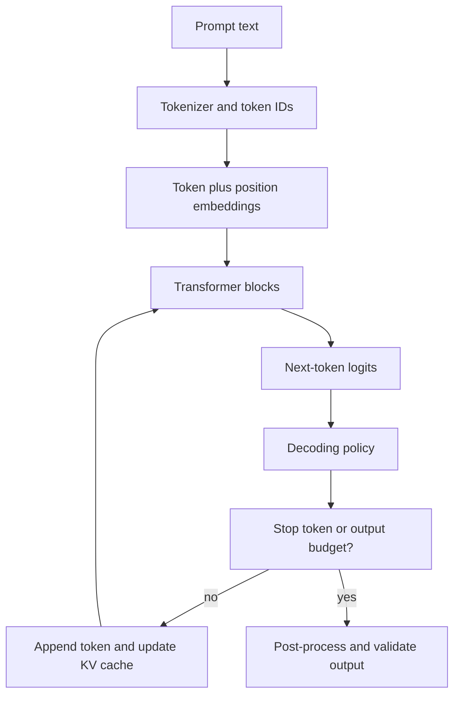

# Stage 04 — Transformers, LLMs & Generative AI

## Outcome
Trace text through tokenization, embeddings, transformer blocks and autoregressive generation; choose adaptation and inference strategies using measured quality, memory and latency.

### Tokenization and vocabulary
Inspect encode/decode, special tokens, padding, truncation and attention masks. Compare token count with word count; test Unicode, rare strings, long inputs and empty input. Version tokenizer and model together.

### Embeddings and positional information
Explain embedding lookup and positional information, including learned positions and RoPE. Inspect [batch, sequence, hidden] shapes and positional effects. Test padding positions, mask broadcasting and context extension.

### Self-attention Q/K/V
Derive Q=XWQ, K=XWK, V=XWV and softmax(QKᵀ/√dₖ)V. Calculate attention for a tiny matrix in NumPy, then compare with framework output. Test causal/padding masks and numerical stability. Explain quadratic sequence cost.

### Multi-head attention and transformer blocks
Explain head splitting/concatenation, output projection, residual paths, LayerNorm and feed-forward layers. Implement one block with explicit shapes. Test hidden-size divisibility, mask dimensions and residual compatibility. Profile activation memory.

### Decoder-only LLMs
Explain next-token objective, causal masking, teacher forcing, context window and KV cache. Inspect shifted labels/logits on a toy sequence. Test future-token leakage and cache consistency. Distinguish prefill from decode capacity.

### Generation and decoding
Compare greedy, temperature, top-k, top-p, repetition penalties, stop sequences and constrained decoding. Sample a toy distribution with a fixed seed. Test invalid parameters, stop token and output limits. Bound token count, latency and spend.

### Fine-tuning and adaptation
Compare supervised fine-tuning, full fine-tuning and PEFT/LoRA/QLoRA. Build a tiny adapter experiment where hardware permits; otherwise produce a measured hardware-feasibility plan. Test duplicate examples, leakage, prompt-format mismatch and overfit. Track data license, privacy and adapter version.

### Inference engineering
Cover quantization, batching, streaming, caching, cancellation, admission control and timeouts. Benchmark multiple batch/sequence sizes and report p50/p95 latency and tokens/sec. Test cold starts, memory exhaustion and concurrent requests. Capacity-plan weights and KV cache on target hardware.

## Stage project — Inspect and serve a small LLM
Select a small documented model; inspect tokenizer/config; verify attention; compare decoding; optionally run PEFT; expose a bounded API with health checks and structured telemetry. Deliver quality, latency, memory and cost report.

## Mastery gate
Explain each transformer tensor, calculate tiny attention, diagnose masking and justify an inference configuration.

## Primary references
- Transformers: https://huggingface.co/docs/transformers/index
- Tokenizers: https://huggingface.co/docs/tokenizers/index
- PEFT: https://huggingface.co/docs/peft/index
- PyTorch SDPA: https://pytorch.org/docs/stable/generated/torch.nn.functional.scaled_dot_product_attention.html

## Stage workflow diagram

Use this flow as the implementation order. The decision branches are the points where tests, policy checks or operational controls must stop unsafe progress.

