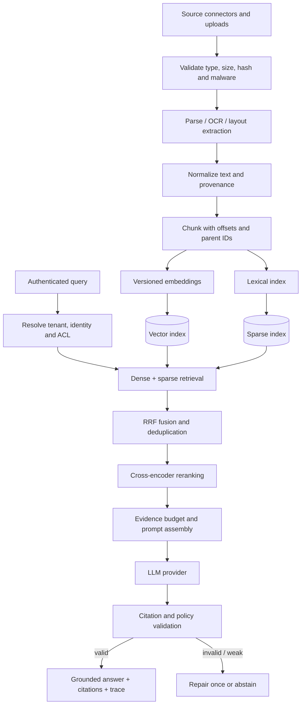

# Stage 05 — RAG, Visual RAG & Knowledge Systems

> **Mastery objective:** build a measurable, permission-aware retrieval system that returns evidence with source provenance, produces grounded answers or abstains, and can explain its retrieval and generation decisions across text, visual and time-based media.

## Learning contract and trust boundaries

RAG is not "put documents in a vector database and ask an LLM." It is a data pipeline, authorization system, search system, evidence assembly process, generation boundary and evaluation discipline. Every transformation must preserve provenance. Tenant identity and document permissions are derived by trusted server-side identity and database policy—not from the browser, prompt or retrieved document.

Each topic requires a worked calculation, implementation, failure injection, negative test and evidence artifact. The deterministic Python reference examples are executable teaching algorithms; hashed vectors, lexical overlap and heuristic reranking are not substitutes for trained embedding models, BM25 libraries or cross-encoders. The backend API demonstrates real sentence-transformer embeddings, pgvector and BM25, but remains an integration foundation until the production gates below are met.

## End-to-end architecture

**Non-negotiable ordering:** authenticate → authorize → retrieve only allowed material → rerank → assemble evidence → generate → validate citations → return. Filtering after generation is too late because unauthorized content may already have entered the model context.

## Topic 1 — Document ingestion, parsing and provenance

Ingestion accepts a bounded set of file types and converts them into normalized records. Preserve immutable source ID, tenant, owner/ACL, original SHA-256, filename, MIME type, parser/version, page, section, character offsets, extraction confidence and document version. Digital PDF, scanned PDF, DOCX, HTML, image and connector adapters have different failure modes. Malware scanning and parser isolation belong before extraction. Raw files should use private encrypted storage with explicit retention and deletion policies.

**Worked calculation:** a 10-page PDF with 2 scanned pages should return 10 page records, of which exactly 2 record OCR provenance. If the parser produces 8 pages or loses page IDs, the ingestion is incomplete even when extracted text looks plausible.

**Numerical animation storyboard:** show a file moving through signature/MIME validation, checksum, parser selection, page extraction, OCR fallback and provenance attachment. Inject a corrupt page and show a page-specific error rather than silently dropping it.

**Implementation:** `extract_document`, `ExtractedPage`, `sha256` and parser adapters in backend/app/ingestion.py. The current API handles PDF/DOCX; HTML, images, audio/video, malware scanning, OCR confidence and isolated workers remain production extensions.

**Failure lab:** spoofed MIME, wrong extension, corrupt/encrypted PDF, scanned page without OCR, decompression bomb, huge file, parser timeout, empty extraction, duplicate upload and malicious embedded content.

**Assessment gate:** produce an ingestion manifest that links every extracted segment to an immutable source, page/section and parser version; explain how retries remain idempotent.

## Topic 2 — Chunking strategies and source offsets

Chunking balances retrieval precision, semantic completeness, context cost and citation resolution. Compare fixed token/character windows, sentence-aware, recursive, heading-aware, semantic and parent-child chunking. Overlap reduces boundary loss but duplicates context and can distort ranking. A chunk should carry parent ID, chunk index, source offsets, page/section, tenant and ACL metadata.

**Worked calculation:** for 1,000 tokens, chunk size 200 and overlap 40, stride is 160 and approximate chunk count is (\lceil(1000-40)/160\rceil=6). Six chunks overlap by 200 tokens in total; measure whether recall improvement justifies the extra index and context cost.

**Numerical animation storyboard:** move a window across a paragraph, highlight exact character/token offsets, then compare a sentence-aware boundary with a fixed split that separates a rule from its exception. Toggle overlap and display duplicate-token percentage.

**Implementation:** `chunk_text` in examples/stage-05/rag_algorithms.py and `chunk_pages` in backend/app/ingestion.py. Keep source offsets through any normalization map.

**Failure lab:** split a sentence at a negation, detach a table heading from its rows, overlap >= chunk size, repeat headers, split multilingual graphemes and produce a chunk with no source offsets.

**Assessment gate:** compare at least three strategies on a labeled query set and report answer-bearing chunk recall, duplication, tokens per query and citation accuracy.

## Topic 3 — Embedding models and vector spaces

An embedding model maps text to a vector (v\in\mathbb{R}^d). Cosine similarity is (\frac{a\cdot b}{\|a\|\|b\|}); dot product and cosine rankings differ when vectors are not normalized. Query and document encoders must share a compatible model/version, tokenizer, dimension and normalization policy. Domain language, multilingual text and asymmetric query/document encoders require evaluation.

**Worked calculation:** normalized vectors (q=[1,0]), (d_1=[0.8,0.6]), (d_2=[0,1]) yield cosine scores 0.8 and 0.0. A score is a ranking signal, not a probability of truth.

**Numerical animation storyboard:** rotate a query vector through a 2D embedding plane, display dot product and cosine, then show how a dimension/model mismatch must stop indexing rather than produce meaningless scores.

**Implementation:** `cosine_similarity`, dense search and the SentenceTransformers encoder in backend/app/main.py. Version model name, immutable revision, dimension and normalization in every index manifest.

**Failure lab:** query/document model mismatch, wrong vector dimension, zero vector, non-finite values, multilingual domain drift, quantization drift and re-embedding only part of a collection.

**Assessment gate:** explain vector-space compatibility, reproduce cosine rankings and design a safe model/index migration with a rollback path.

## Topic 4 — Vector indexes, metadata filters and pgvector

Exact search is the correctness baseline. Approximate nearest-neighbor indexes such as HNSW/IVF trade recall for latency and memory. Metadata filters constrain candidate sets and must be applied with tenant/ACL policy. Measure ANN Recall@K against exact search, filtered recall, p50/p95 latency, memory, index build time and update behavior. Plan backup, restore and rebuild.

**Worked calculation:** exact top-3 is [A,B,C], ANN returns [A,C,D]; Recall@3 is 2/3. A fast index that excludes the only answer-bearing item is not acceptable.

**Numerical animation storyboard:** compare exact scan with HNSW graph traversal, then apply a tenant filter before ranking. Display candidate count, latency and recall.

**Implementation:** pgvector cosine search in backend/app/main.py and `dense_search` in examples/stage-05/rag_algorithms.py.

**Failure lab:** empty index, duplicate IDs, wrong metric/operator class, stale embedding version, selective ACL filter, index rebuild under load and tenant filter accidentally omitted.

**Assessment gate:** publish exact-vs-ANN results and prove tenant/ACL filters are applied before retrieved content is exposed.

## Topic 5 — Sparse, dense and hybrid retrieval

Sparse retrieval such as BM25 rewards lexical matches and term rarity; dense retrieval captures semantic similarity; hybrid retrieval combines complementary signals. Reciprocal Rank Fusion is (RRF(d)=\sum_r\frac{1}{k+rank_r(d)}). Query rewriting, multi-query and metadata filters can help, but each extra query increases latency and can introduce drift.

**Worked calculation:** with k=60, a document ranked 1st in one list scores 1/61≈0.01639; rank 10 scores 1/70≈0.01429. If the same document appears in two lists at ranks 2 and 4, its score is 1/62+1/64≈0.03175.

**Numerical animation storyboard:** rank candidates separately for exact policy identifiers and paraphrases, then fuse ranks with RRF. Toggle a metadata filter and show an unauthorized result disappear before context assembly.

**Implementation:** `bm25_scores`, `reciprocal_rank_fusion`, `hybrid_search` and the production SQL BM25/RRF path in backend/app/main.py.

**Failure lab:** typo, rare identifier, stopword-heavy query, stale version, duplicate chunks, zero lexical terms, tenant ACL mismatch and dense model drift.

**Assessment gate:** compare sparse/dense/hybrid on golden queries with Recall@K, MRR, nDCG, latency and ACL leakage tests. Do not claim hybrid is better without measured evidence.

## Topic 6 — Grounded answer generation, citations and abstention

Generation receives only authorized, deduplicated, bounded evidence. Treat retrieved content as untrusted data, not instructions. Prompt structure should separate system policy, user question and quoted evidence. The output schema should contain answer, citations, confidence/evidence coverage and abstention reason. Validate every citation against retrieved source IDs and exact spans. Contradictory or insufficient evidence should trigger abstention or a bounded repair—not invented certainty.

**Worked calculation:** if an answer contains 4 citations and 3 resolve to retrieved source spans, citation precision is 3/4=0.75. A high language-model confidence does not repair the invalid citation.

**Numerical animation storyboard:** assemble evidence cards with source/page/span, generate a structured answer, highlight each cited quote in the source and reject one fabricated source ID.

**Implementation:** `validate_citations` in examples/stage-05/rag_algorithms.py. The current API returns retrieval evidence; a real generation provider and citation gate must be configured before answer generation is enabled.

**Failure lab:** fabricated citation, quote not present, conflicting sources, prompt injection inside a document, no-answer question, stale policy and evidence overflow.

**Assessment gate:** demonstrate that every factual claim maps to authorized evidence or the system abstains. Include a malicious-document test and an exact citation-span validator.

## Topic 7 — Reranking and context assembly

A retriever should fetch a wider candidate set; a cross-encoder or late-interaction reranker then scores query-document pairs more precisely. Reranking cannot recover documents absent from the candidate pool. Deduplicate overlapping chunks, diversify sources when appropriate, preserve parent context and allocate a strict token budget. Measure relevance lift against added latency.

**Worked calculation:** first-stage ranks [A,B,C,D,E] with relevance [0,0,0,1,0]. A reranker that produces [D,A,B] moves the relevant result from rank 4 to rank 1; MRR improves from 1/4 to 1.0.

**Numerical animation storyboard:** show 20 candidates from dense/sparse retrieval, score query-passage pairs, reorder the top five, remove near-duplicate chunks and pack the remaining evidence into a token budget.

**Implementation:** `rerank_by_scores` is a deterministic interface demonstration only. Replace its score source with a versioned cross-encoder and retain model/version/latency traces.

**Failure lab:** relevant item absent from candidates, reranker timeout, input truncation, duplicate passage domination, cross-tenant candidate and unbounded evidence context.

**Assessment gate:** report Recall@candidate, nDCG before/after reranking, p95 latency and context tokens. State the limitations of any heuristic scorer.

## Topic 8 — Adaptive and agentic RAG

Start with deterministic retrieval. Add bounded query decomposition, routing or corrective retrieval only when evidence coverage is low or the question requires multiple facets. The controller needs explicit max rounds, tool allowlists, timeout, token/spend budget, duplicate-query detection and stop reason. Agentic retrieval is not permission to bypass ACL or invoke arbitrary tools.

**Worked calculation:** a two-facet question has coverage 0.5 after the first query and 1.0 after a bounded second query. If max_rounds=2, the controller stops even if the second search returns no new evidence.

**Numerical animation storyboard:** display query → retrieve → coverage score → one rewrite → retrieve → stop. Toggle a no-result branch and show the hard iteration cap.

**Implementation:** `bounded_adaptive_retrieval` in examples/stage-05/rag_algorithms.py.

**Failure lab:** infinite no-result loop, repeated query, tool timeout, prompt injection instructing a tool call, cost budget exhaustion and a rewrite that broadens tenant scope.

**Assessment gate:** prove the controller terminates under every branch and can explain why it stopped. Measure answer coverage gain against added latency/cost.

## Topic 9 — GraphRAG and knowledge graphs

Extract typed entities and relations with source spans, confidence and document version. Resolve aliases and ambiguity before joining entities. Graph traversal can connect facts across documents, while community summaries support global questions. Extracted edges are hypotheses until validated against evidence; never turn a low-confidence relation into a factual answer.

**Worked calculation:** Alice —works_for→ Acme (evidence E1), Acme —located_in→ Bengaluru (E2). A two-hop answer needs both edges and both source references. Removing E2 makes the destination unsupported.

**Numerical animation storyboard:** select a seed entity, traverse one then two hops, filter low-confidence edges and open the source span behind each edge.

**Implementation:** `bounded_graph_traversal` in examples/stage-05/rag_algorithms.py.

**Failure lab:** ambiguous entity, alias collision, unsupported edge, stale relation, unbounded traversal, cross-tenant graph edge and missing provenance.

**Assessment gate:** return a bounded path with evidence for every edge and explain entity resolution, confidence and graph staleness.

## Topic 10 — Visual RAG for PDFs, tables and images

Visual RAG combines page rendering, layout detection, OCR, table extraction, image embeddings and text retrieval. Retain page image, region bounding boxes, reading order, OCR confidence and links between captions/tables/figures and source text. A text-only parser may flatten tables or miss diagram relationships. Enforce page, pixel and image-size budgets.

**Worked calculation:** a page rendered at 150 DPI has width (8.5\times150=1275) pixels and height (11\times150=1650) pixels. Doubling DPI quadruples pixel count and can sharply increase memory.

**Numerical animation storyboard:** render a page, detect heading/table/figure boxes, overlay OCR spans and show the exact crop returned by retrieval with page and region coordinates.

**Implementation:** `validate_visual_regions` validates page coordinates; backend PDF OCR currently extracts text but does not preserve layout, region coordinates or OCR confidence.

**Failure lab:** rotated scan, low resolution, two-column reading order, table row misalignment, wrong bounding box, oversized page and OCR confidence below threshold.

**Assessment gate:** cite a page and region, preserve table structure and report OCR confidence/quality limits. Do not claim full Visual RAG from a schematic page viewer.

## Topic 11 — Audio and video RAG

Audio/video retrieval uses timestamped transcript segments, speaker metadata, sampled keyframes, scene boundaries and cross-modal links. Keep time units explicit and align transcript intervals with frame timestamps. Consent, retention, redaction and media access controls are mandatory. Avoid indexing sensitive speech or faces without a lawful purpose and clear authorization.

**Worked calculation:** transcript segment 10,000–12,000 ms and nearest keyframe 12,400 ms have a 400 ms gap. With max_gap=500 ms they can be linked; with max_gap=250 ms they remain separate.

**Numerical animation storyboard:** timeline shows audio segments and sampled frames; move a tolerance slider and highlight aligned or unaligned evidence.

**Implementation:** `align_media_timeline` in examples/stage-05/rag_algorithms.py. This is a timestamp-alignment reference, not a speech recognizer or video embedding service.

**Failure lab:** noisy transcript, overlapping speakers, timestamp drift, repeated keyframes, missing audio, large media file, consent withdrawal and retention expiry.

**Assessment gate:** retrieve a time-bounded segment and matching frame, preserve media provenance and explain consent/retention controls.

## Topic 12 — RAG evaluation, safety and optimization

Evaluation needs a versioned golden set containing query, expected answer facts, relevant evidence IDs, ACL context and no-answer cases. Retrieval metrics include Recall@K, Precision@K, MRR and nDCG. Generation metrics include correctness, faithfulness, citation precision/recall, abstention quality and contradiction handling. Operational metrics include p50/p95 latency, tokens, cost, ingestion delay, error rates and index freshness. Slice results by language, tenant, document type and query difficulty.

**Worked calculation:** if 8 of 10 relevant evidence IDs appear in top-5, Recall@5=0.8. If the first relevant result is rank 2, reciprocal rank is 0.5. Retrieval recall and answer faithfulness measure different failure points.

**Numerical animation storyboard:** run a fixed golden set through dense, sparse, hybrid and reranked pipelines; show metric deltas and flag a critical ACL/citation regression even if average relevance improves.

**Implementation:** `recall_at_k`, `precision_at_k`, `mean_reciprocal_rank`, `ndcg_at_k` and `validate_citations` in examples/stage-05/rag_algorithms.py.

**Failure lab:** answer leakage from another tenant, malicious document instruction, fabricated citation, stale source, no-answer hallucination, language regression and latency/cost budget breach.

**Assessment gate:** produce a versioned evaluation report with retrieval, generation, security and operational metrics. Release only when critical tenant-isolation and citation regressions are zero.

## Stage 5 integrated project — Multi-tenant evidence-grounded knowledge assistant

Build ingestion → provenance-preserving chunking → versioned embeddings → vector and lexical indexes → ACL-filtered hybrid retrieval → reranking → bounded evidence context → model adapter → citation validation/abstention → trace and evaluation. The current backend is a local-first API foundation using FastAPI, RS256/JWKS identity verification, PostgreSQL RLS, pgvector, sentence-transformer embeddings and BM25/RRF. It is not production-certified or deployed.

Project deliverables:
- 30+ versioned golden questions, including answerable, no-answer, conflicting-source and prompt-injection cases.
- Source/page/span citations and a document data card.
- Tenant and document-ACL isolation tests using a restricted non-owner database role.
- Ingestion retry, duplicate/idempotency and deletion/retention tests.
- Retrieval and answer metrics plus p50/p95 latency, throughput, memory and cost report.
- Threat model, runbook, backup/restore and index-rebuild procedure.

## Production readiness gates

1. Integrate the actual Academy identity provider and verify issuer, audience, JWKS rotation and tenant/role claims.
2. Add document ACLs, forced RLS and cross-tenant integration tests.
3. Move parsing/OCR/embedding into bounded durable workers with retries, dead-letter handling and per-tenant quotas.
4. Use private encrypted object storage, malware scanning, retention and deletion workflows where raw-file retention is required.
5. Add distributed rate limits, audit events, structured traces, metrics and cost budgets.
6. Validate citations and abstention with a real configured model adapter; no provider credentials or external calls are enabled by this curriculum change.
7. Run load/security tests, migration verification, backup/restore drills and independent security review.

Do not deploy to a 512 MB Render Free instance: the current sentence-transformer model, OCR and parsing can exceed that memory budget. No paid infrastructure or cloud resources are provisioned by this stage.

## Primary references

- Sentence Transformers: https://sbert.net/
- pgvector: https://github.com/pgvector/pgvector
- LlamaIndex: https://docs.llamaindex.ai/
- OWASP LLM Top 10: https://genai.owasp.org/llm-top-10/
- RAGAS: https://docs.ragas.io/
- BEIR benchmark: https://github.com/beir-cellar/beir
