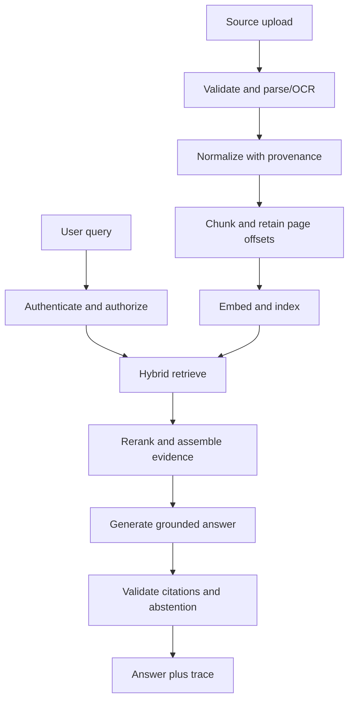

# Stage 05 — RAG, Visual RAG & Knowledge Systems

## Outcome
Build evidence-grounded retrieval with citations, authorization and measurable quality, including scanned PDFs, images, audio and video.

## Reference architecture
Ingestion: connectors → validation → parsing/OCR → normalized records with provenance → chunking → embeddings → vector/keyword indexes.
Query: authenticate → authorize/filter → retrieve → fuse/rerank → bounded evidence context → generate → validate citations → return answer and trace.

### Document ingestion and parsing
Build adapters for digital PDF, scanned PDF, DOCX, HTML and images. Preserve source ID, page, section, offsets and extraction confidence. Test corrupt/encrypted files, empty extraction, huge files and malformed metadata. Enforce MIME, size and page limits; quarantine uploads.

### Chunking strategies
Compare fixed-token, sentence, paragraph, heading-aware and semantic splitting. Add overlap and preserve parent IDs/offsets. Test answers crossing boundaries, repeated headers, tables and short documents. Measure retrieval recall and context cost.

### Embedding models and vector spaces
Encode queries/documents with compatible models; compare cosine and dot product. Test dimension/model mismatch, multilingual data and domain terms. Version embedding model and index; never mix incompatible vector spaces.

### Vector indexes and databases
Compare exact search with ANN concepts (HNSW/IVF). Implement exact cosine baseline then pgvector. Measure recall against exact top-K, latency and memory. Test empty index, duplicate IDs and selective metadata filters. Plan backup and rebuild.

### Retrieval strategies
Compare dense, lexical/BM25, hybrid fusion, metadata filtering, query rewriting and multi-query. Evaluate Recall@K, MRR and nDCG on labeled queries. Test identifiers, paraphrases, typos, stale sources and ACL filtering. Enforce authorization before model context.

### Grounded answer generation
Use evidence-bounded prompts and structured answer/citation schema. Validate every citation against retrieved source IDs/spans. Test no-answer questions, conflicting sources, malicious instructions in documents and fabricated citations. Abstain when evidence is insufficient.

### Reranking and relevance optimization
Compare bi-encoder retrieval and cross-encoder reranking. Retrieve wider candidates, rerank top-N and evaluate final top-K. Measure latency and test truncation/irrelevant lexical matches. Budget reranking cost.

### Adaptive and agentic RAG
Start with deterministic retrieval; add bounded query decomposition/retry only when evidence coverage is low. Test max-iteration termination, no-result loops, tool timeout and conflicting evidence. Cap steps, tokens and spend.

### GraphRAG and knowledge graphs
Extract typed entities/relations with source spans; run one-hop and two-hop queries. Test entity ambiguity, duplicates, unsupported edges and stale facts. Treat extracted relations as uncertain until evidence is checked.

### Visual RAG for PDFs and images
Render pages, extract text/OCR, retain page images and region metadata. Test rotated/low-resolution scans, tables, diagrams and OCR confidence. Cite page and region; enforce pixel/page/file limits.

### Audio and video RAG
Create timestamped transcript segments and sampled keyframes; link segments to media offsets. Test noisy audio, overlapping speakers, silence, repeated frames and timestamp drift. Apply consent and retention controls.

### RAG evaluation and optimization
Measure Recall@K/MRR/nDCG, answer correctness, faithfulness, citation precision/recall, abstention, latency and cost. Build versioned golden questions with expected evidence IDs. Include prompt injection, no-answer, stale source and ACL tests. Gate releases on critical regressions.

## Stage project — Multi-tenant knowledge assistant
Implement ingestion, chunking, indexing, hybrid retrieval, reranking, grounded generation and page citations. Include 30 golden questions, cross-tenant isolation tests, malicious-document tests and latency/cost report.

## Mastery gate
Every claim must be supported by accessible evidence; citations resolve to source locations; retrieval is measured; unauthorized sources never enter context.

## Primary references
- Sentence Transformers: https://sbert.net/
- pgvector: https://github.com/pgvector/pgvector
- LlamaIndex: https://docs.llamaindex.ai/
- OWASP LLM Top 10: https://genai.owasp.org/llm-top-10/

## Stage workflow diagram

Use this flow as the implementation order. The decision branches are the points where tests, policy checks or operational controls must stop unsafe progress.

## Production implementation extension

Continue with [Production RAG with Qdrant, LangSmith and Guardrails AI](../production-playbooks/01-production-rag-qdrant-langsmith.md). It adds a runnable local-first implementation sequence, tenant/ACL threat tests, dense-vs-lexical-vs-hybrid experiments, RRF and reranking, citation validation, LangSmith trace design, Guardrails validation boundaries and a retrieval debugging decision tree. Use the playbook after understanding the concepts in this stage guide.
