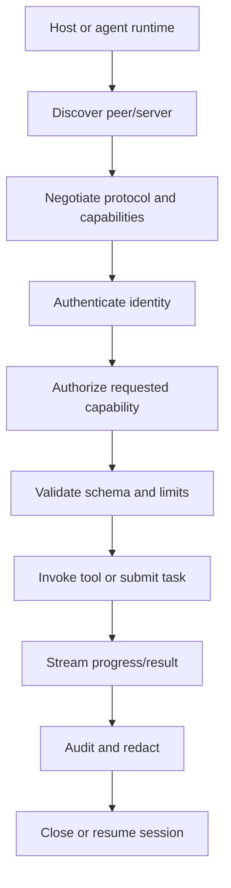

# Stage 07 — MCP, A2A, ACP & Tool Ecosystems

## Outcome
Build interoperable tool and agent integrations while understanding protocol boundaries, lifecycle, identity, trust and transport security.

### MCP architecture and lifecycle
Understand host, client and server responsibilities; initialize, negotiate capabilities, list tools/resources/prompts, invoke and shut down. Build a local read-only server and client. Inspect JSON-RPC envelopes and protocol errors. The host owns user policy; a server description is not authorization.

### MCP tools, resources and prompts
Design typed tool schemas, read-only resources and reusable prompts. Validate arguments, reject unexpected fields and return structured errors. Test malformed arguments, large results and tool-name collisions. Keep tools narrowly scoped and expose only necessary data.

### MCP advanced capabilities
Study sampling, elicitation, roots, notifications, progress, cancellation and subscriptions where supported by the SDK/version. Implement progress and cancellation in a slow read-only operation. Test disconnects and unsupported capability negotiation. Document version compatibility rather than assuming every client supports every feature.

### MCP transport and deployment
Compare local stdio with remote HTTP-based transport supported by the selected protocol/SDK version. Configure process lifecycle, environment, authentication, TLS, timeouts and health checks. For stdio, reserve stdout for protocol frames. Test reconnect, malformed frames and secret leakage.

### MCP security engineering
Threat-model confused deputy, tool poisoning, prompt injection, overbroad scopes, SSRF, path traversal and credential exposure. Authorize every call against the authenticated principal and resource. Test cross-user access, malicious tool metadata and argument tampering. Audit action identity and redact secrets.

### Agent2Agent protocol
Understand agent discovery/cards, task lifecycle, messages, artifacts and asynchronous status. Build a mock agent card and a task client/server flow. Test unknown capabilities, expired task, duplicate submission and artifact access. Authenticate agents and validate callback destinations.

### IBM/BeeAI Agent Communication Protocol
Study the protocol's agent discovery, message/task exchange and lifecycle against its current implementation documentation. Build an isolated adapter with typed internal messages; do not couple domain logic to wire schemas. Test version mismatch, unknown message types and failure responses. Verify current project status before selecting it for production.

### Agent Client Protocol
Understand editor/client-to-agent interaction, session lifecycle, streaming updates and tool approval semantics. Build a protocol adapter mock and test session resume, cancellation and permission prompts. Keep editor-specific concerns outside the agent core.

### Tool integration engineering
Create a typed adapter boundary for every external API. Add schema validation, authentication, rate limits, retries with backoff, idempotency, timeouts and redaction. Test 429, 5xx, malformed response, partial failure and token expiry. Maintain an inventory and revocation path.

## Stage project — Multi-protocol tool gateway
Expose one harmless read-only capability through a local MCP server and a separate internal agent adapter. Add identity propagation, schema validation, audit events, timeout/cancellation and protocol conformance tests. Document what each protocol does and does not standardize.

## Mastery gate
Trace a complete MCP lifecycle, distinguish MCP from agent-to-agent protocols, and demonstrate authorization at the execution boundary.

## Primary references
- MCP specification: https://modelcontextprotocol.io/specification/
- MCP Python SDK: https://github.com/modelcontextprotocol/python-sdk
- A2A protocol: https://a2a-protocol.org/
- Agent Client Protocol: https://agentclientprotocol.com/

## Stage workflow diagram

Use this flow as the implementation order. The decision branches are the points where tests, policy checks or operational controls must stop unsafe progress.

