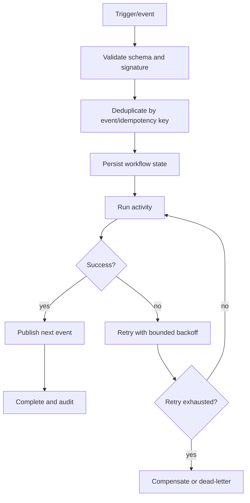

# Stage 08 — Automation & Workflow Orchestration

## Outcome
Build reliable event-driven workflows with retries, idempotency, durable state and explicit compensation rather than fragile chains of API calls.

### Workflow patterns
Compare sequential, parallel fan-out/fan-in, conditional, saga, approval and scheduled workflows. Draw state and failure paths before implementation. Test partial branch failure, cancellation and compensation. Choose orchestration when central visibility/control matters; choose choreography when independent services can safely react to events.

### Event-driven automation
Define event envelopes with event ID, type, schema version, timestamp, tenant and correlation ID. Implement producer/consumer with validation and deduplication. Test duplicate, out-of-order, poison and delayed events. Use an outbox or equivalent reliable publish pattern where database writes and event publication must stay consistent.

### Durable workflow engines
Model activities, retries, timeouts, heartbeats, checkpoints and compensation. Simulate worker crash before and after side effect. Test replay determinism, retry exhaustion and long-running waits. Persist state and use idempotency at external side-effect boundaries.

### Automation platform integration
Build provider adapters for webhooks/API automation tools; validate signatures, map external payloads into internal events and enforce scopes. Test replay attacks, schema changes, provider rate limits and credential rotation. Keep provider-specific logic in adapters.

## Stage project — Order fulfilment saga
Implement order accepted → inventory reserved → payment authorized → shipment requested → completion. Add compensations for inventory release and payment void; require human review for ambiguous outcomes. Include idempotency, event log, retry policy, dead-letter handling and sequence diagram.

## Mastery gate
Demonstrate recovery after worker crash, duplicate event safety and a tested compensation path.

## Primary references
- Temporal documentation: https://docs.temporal.io/
- CloudEvents: https://cloudevents.io/
- AWS outbox pattern guidance: https://docs.aws.amazon.com/prescriptive-guidance/latest/cloud-design-patterns/transactional-outbox.html

## Stage workflow diagram

Use this flow as the implementation order. The decision branches are the points where tests, policy checks or operational controls must stop unsafe progress.

