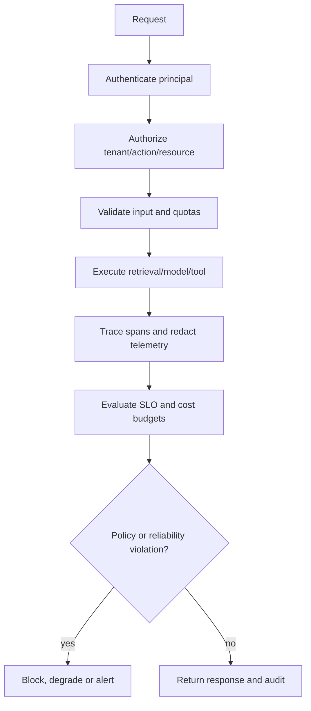

# Stage 10 — Security, Observability & Production Architecture

## Outcome
Threat-model AI systems, enforce authorization outside model instructions, observe full request paths and operate to measurable SLOs.

### Prompt injection and data exfiltration
Distinguish direct and indirect injection; treat retrieved content and tool output as untrusted data. Build a test corpus with malicious documents and extraction attempts. Test instruction hierarchy bypass, secret requests and cross-document leakage. Use least privilege, data minimization and output validation; prompting alone is not a security boundary.

### Tool authorization and sandboxing
Define principal, action, resource and policy. Authorize every tool call server-side; isolate untrusted execution and restrict filesystem/network access. Test argument tampering, path traversal, SSRF, privilege escalation and replay. Require approval for consequential actions.

### Multi-tenant security
Enforce tenant identity from trusted authentication context, not user-supplied IDs. Apply tenant filters to every query and storage key. Test cross-tenant reads/writes, cache-key collision, background job context loss and vector search leakage. Audit access and retention.

### AI supply-chain security
Inventory models, datasets, packages, prompts, tools and containers. Verify provenance, licenses, checksums and vulnerability status. Test poisoned dependency/model artifact and secret in build logs. Pin versions and maintain revocation/rollback procedures.

### Tracing and telemetry
Trace request → retrieval → model → tool → response with correlation IDs. Record latency, token counts, retrieval IDs and error categories while redacting sensitive content. Test missing spans, cardinality explosion and trace sampling. Keep metrics, logs and traces distinct.

### SLOs and reliability
Define user-facing SLIs such as availability, p95 latency, task success and grounded answer rate. Set SLO windows and error budgets. Test dependency outage, timeout and saturation. Design graceful degradation and incident escalation.

### AI cost engineering
Calculate per-request cost from input/output tokens, embeddings, reranking, storage, compute and retries. Build budgets and quotas. Test prompt bloat, runaway loops, cache invalidation and expensive retries. Report cost per successful task, not only cost per call.

### Incident response and debugging
Create severity levels, on-call runbook, evidence preservation, mitigation and postmortem template. Practice model provider outage, data exposure, bad deployment and retrieval regression. Test rollback, credential rotation and communication. Avoid logging secrets during diagnosis.

## Stage project — Secure observable RAG/agent service
Threat-model a multi-tenant RAG service with scoped tools. Implement policy checks, prompt-injection test corpus, redacted traces, SLO dashboard, budget limits and incident runbooks. Demonstrate a blocked attack and a graceful dependency outage.

## Mastery gate
Prove tenant isolation, enforce server-side authorization, show traceability without sensitive logging and execute a tested rollback/incident drill.

## Primary references
- OWASP GenAI: https://genai.owasp.org/llm-top-10/
- NIST AI RMF: https://www.nist.gov/itl/ai-risk-management-framework
- OpenTelemetry: https://opentelemetry.io/docs/
- SRE workbook: https://sre.google/workbook/table-of-contents/

## Stage workflow diagram

Use this flow as the implementation order. The decision branches are the points where tests, policy checks or operational controls must stop unsafe progress.

## Interview preparation integration

Use the [Agentic AI Interview Preparation track](../interview-prep/README.md) to practice this stage in timed interview conditions. The track includes a scenario prompt, answer outline, interviewer follow-ups, failure injection and a scored self-review rubric.
