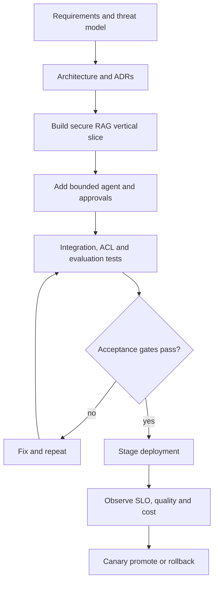

# Stage 11 — Enterprise Capstone & Architecture

## Outcome
Design, implement and operate a multi-tenant knowledge and agent platform with explicit security boundaries, reproducible evaluation and a defensible operational plan.

### Architecture and threat model
Gather functional/non-functional requirements, users, data classes, trust boundaries, scale assumptions and SLOs. Draw context/container/component/data-flow diagrams. Record ADRs for storage, retrieval, model, orchestration and deployment choices. Threat-model tenant escape, prompt injection, tool abuse, data exfiltration, supply-chain compromise and provider outage. Define mitigations and residual risks.

### Architecture and threat model
Gather functional and non-functional requirements, user journeys, data classes, workload assumptions, retention/residency constraints and measurable SLO/quality/cost objectives. Produce system-context, container, component, deployment and data-flow views; label trust boundaries, identity propagation and data egress. Record ADRs for storage/RLS, vector isolation, model/provider, orchestration, MCP/A2A, queues, deployment and observability. Each ADR must include context, alternatives, decision, consequences and revisit triggers.

Threat-model with STRIDE and AI-specific abuse cases: tenant escape, prompt injection, retrieval poisoning, data exfiltration, unsafe tool execution, agent loop abuse, model/dependency compromise, forged queue context and denial of wallet. Each threat needs an asset, actor, entry point, attack path, likelihood/impact, preventive/detective/recovery controls, negative test evidence and residual-risk owner. Critical tenant-isolation or authorization failures are stop-ship conditions.

**Architecture acceptance gate:** every sensitive flow must be encrypted, authenticated, tenant-scoped and authorized; model output cannot grant permissions; mutating tools require policy and approval; async jobs require tenant context and idempotency; release artifacts require provenance and rollback compatibility.

### Build RAG and agent services
Implement document ingestion, parsing/OCR, provenance, chunking, embeddings, hybrid retrieval, reranking, grounded answer generation and citations. Add a bounded agent with typed tools, explicit authorization, durable state and approval for mutations. Build API contracts, schema validation, idempotency and integration tests. Keep model-generated plans separate from server-side policy.

### Deploy and operate
Create reproducible container and CI pipeline; run unit/integration/security/evaluation suites; deploy to a staging environment; verify health and quality; promote with canary or controlled rollout. Add traces, metrics, logs, SLOs, budgets, alert thresholds, backup/restore and incident runbooks. Demonstrate rollback and data recovery.

## Required deliverables
1. Architecture diagrams: context, component, deployment, data flow and trust boundaries.
2. ADRs with alternatives, trade-offs and consequences.
3. Threat model with abuse cases, controls, residual risk and test evidence.
4. API and event schemas with versioning strategy.
5. Working vertical slice with tenant isolation and citation verification.
6. Evaluation dataset and report with retrieval, answer, safety, latency and cost metrics.
7. CI/CD workflow and immutable release manifest.
8. Operations pack: SLOs, dashboard definitions, alerts, runbooks, backup/restore and rollback.
9. Demo script that shows normal flow, no-evidence abstention, unauthorized access denial, prompt injection defense and provider outage handling.

## Acceptance tests
- Tenant A cannot read Tenant B documents, embeddings, caches, traces or job state.
- Every cited answer resolves to a source page/chunk and unsupported answers abstain.
- Malicious retrieved text cannot grant tools or change server-side permissions.
- Mutating tools require explicit approval and are idempotent.
- Retry/restart does not duplicate external side effects.
- Evaluation regression blocks promotion.
- Rollback restores a known-good release and compatible artifacts.
- Cost and latency remain inside documented budgets under a representative load test.

## Final review rubric
Score each area 0–4: correctness, architecture, security, reliability, evaluation, observability, cost, documentation and operability. A zero in tenant isolation, authorization or data handling is an automatic failure regardless of aggregate score.

## Mastery gate
Present the architecture, defend trade-offs, reproduce the evaluation, demonstrate attack resistance and operate the system through a failure/rollback exercise.

## Primary references
- OWASP GenAI: https://genai.owasp.org/
- NIST AI RMF: https://www.nist.gov/itl/ai-risk-management-framework
- OpenTelemetry: https://opentelemetry.io/docs/
- Docker: https://docs.docker.com/
- Kubernetes: https://kubernetes.io/docs/

## Stage workflow diagram

Use this flow as the implementation order. The decision branches are the points where tests, policy checks or operational controls must stop unsafe progress.

## Interview preparation integration

Use the [Agentic AI Interview Preparation track](../interview-prep/README.md) to practice this stage in timed interview conditions. The track includes a scenario prompt, answer outline, interviewer follow-ups, failure injection and a scored self-review rubric.
