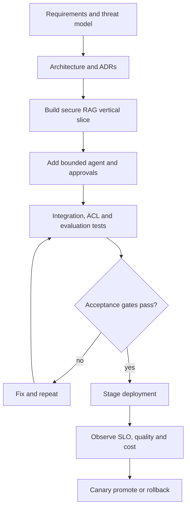

# Stage 11 — Enterprise Capstone & Architecture

## Outcome
Design, implement and operate a multi-tenant knowledge and agent platform with explicit security boundaries, reproducible evaluation and a defensible operational plan.

### Architecture and threat model
Gather functional and non-functional requirements, user journeys, data classes, workload assumptions, retention/residency constraints and measurable SLO/quality/cost objectives. Produce system-context, container, component, deployment and data-flow views; label trust boundaries, identity propagation and data egress. Record ADRs for storage/RLS, vector isolation, model/provider, orchestration, MCP/A2A, queues, deployment and observability. Each ADR must include context, alternatives, decision, consequences and revisit triggers.

Threat-model with STRIDE and AI-specific abuse cases: tenant escape, prompt injection, retrieval poisoning, data exfiltration, unsafe tool execution, agent loop abuse, model/dependency compromise, forged queue context and denial of wallet. Each threat needs an asset, actor, entry point, attack path, likelihood/impact, preventive/detective/recovery controls, negative test evidence and residual-risk owner. Critical tenant-isolation or authorization failures are stop-ship conditions.

**Architecture acceptance gate:** every sensitive flow must be encrypted, authenticated, tenant-scoped and authorized; model output cannot grant permissions; mutating tools require policy and approval; async jobs require tenant context and idempotency; release artifacts require provenance and rollback compatibility.

### Build RAG and agent services
Build one vertical slice before broadening the platform. Define versioned contracts for upload, ingestion status, query, citation, action proposal, approval, tool result and audit event. Implement server-side membership resolution and preserve source hash, parser/chunker/embedding versions, page metadata and stable chunk IDs.

For retrieval, push tenant and document ACL predicates into the query before ranking and top-k. Verify every citation against an immutable document version, page and chunk; abstain when authorized evidence is absent. Treat retrieved text and model output as untrusted data.

Keep agent planning separate from execution. The agent emits typed proposals; the tool gateway checks principal, tenant, role, capability, resource ownership, argument schema, budget and risk tier. Mutations require a separate scoped approval and durable idempotency record. A timeout after commit must return the original operation outcome rather than repeat the side effect.

Add redacted audit events, trace propagation, cost metering, SLO/deadline controls and bounded retries to the same path. Validate positive and negative integration tests: cross-tenant retrieval, citation lineage, no-evidence abstention, prompt injection, unauthorized tools, approval replay, idempotency, budget rejection and provider outage. The local reference implementation is an offline contract simulator; replace its in-memory stores and lexical retrieval with production adapters only after the same invariants are proven with database/RLS and deployment tests.

### Deploy and operate
Create an immutable release manifest binding source commit, image/model/prompt/index/schema versions, API/event contracts, evaluation report, SBOM, provenance, signature and previous compatible rollback target. CI gates include type/lint, unit/integration/contract, PostgreSQL RLS, retrieval/citation, prompt/tool security, model quality/safety, load, cost, migration compatibility and supply-chain verification. Missing evidence blocks promotion.

Use expand/backfill/verify/switch/drain/contract migrations so old and new instances remain compatible during rolling deployment. Deploy to staging, run smoke tests, then use a sample-size-aware canary. Compare error rate, p95, model quality/safety, cost per successful task, queue depth and saturation. Any critical threshold breach halts promotion and restores the full compatible bundle (code/image/model/prompt/index/schema), not just the container.

Operate with user-centered SLO dashboards, traces, redacted logs, actionable alerts, named runbooks, on-call ownership, tenant budget guardrails and backup/restore drills. Record RPO/RTO and prove restore integrity and tenant boundaries. Rehearse provider/vector outages, failed migrations, canary regression, artifact compromise and rollback. The local simulator validates policy logic; production deployment and infrastructure provisioning remain separate approved activities.

## Required deliverables
1. Architecture diagrams: context, component, deployment, data flow and trust boundaries.
2. ADRs with alternatives, trade-offs and consequences.
3. Threat model with abuse cases, controls, residual risk and test evidence.
4. API and event schemas with versioning strategy.
5. Working vertical slice with tenant isolation and citation verification.
6. Evaluation dataset and report with retrieval, answer, safety, latency and cost metrics.
7. CI/CD workflow and immutable release manifest.
8. Operations pack: SLOs, dashboard definitions, alerts, runbooks, backup/restore and rollback.
9. Demo script that shows normal flow, no-evidence abstention, unauthorized access denial, prompt injection defense and provider outage handling.

## Acceptance tests
- Tenant A cannot read Tenant B documents, embeddings, caches, traces or job state.
- Every cited answer resolves to a source page/chunk and unsupported answers abstain.
- Malicious retrieved text cannot grant tools or change server-side permissions.
- Mutating tools require explicit approval and are idempotent.
- Retry/restart does not duplicate external side effects.
- Evaluation regression blocks promotion.
- Rollback restores a known-good release and compatible artifacts.
- Cost and latency remain inside documented budgets under a representative load test.

## Integrated acceptance command

Run the local cross-topic capstone acceptance and all Stage 11 tests:

```bash
python examples/stage-11/capstone_acceptance.py
python -m unittest discover -s examples/stage-11 -p 'test_*.py' -v
```

The acceptance report composes architecture validation, the tenant-scoped RAG/tool vertical slice and release/rollback/recovery gates. It uses synthetic fixtures only and does not provision infrastructure or call external model/tool providers.

## Final review rubric
Score each area 0–4: correctness, architecture, security, reliability, evaluation, observability, cost, documentation and operability. A zero in tenant isolation, authorization or data handling is an automatic failure regardless of aggregate score.

## Mastery gate
Present the architecture, defend trade-offs, reproduce the evaluation, demonstrate attack resistance and operate the system through a failure/rollback exercise.

## Primary references
- OWASP GenAI: https://genai.owasp.org/
- NIST AI RMF: https://www.nist.gov/itl/ai-risk-management-framework
- OpenTelemetry: https://opentelemetry.io/docs/
- Docker: https://docs.docker.com/
- Kubernetes: https://kubernetes.io/docs/


## Stage workflow diagram

Use this flow as the implementation order. The decision branches are the points where tests, policy checks or operational controls must stop unsafe progress.




## Interview preparation integration

Use the [Agentic AI Interview Preparation track](../interview-prep/README.md) to practice this stage in timed interview conditions. The track includes a scenario prompt, answer outline, interviewer follow-ups, failure injection and a scored self-review rubric.
