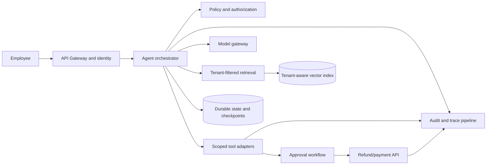

# Agentic AI Interview Preparation

This track is integrated with Stages 6–11; it does not add a twelfth curriculum phase or duplicate the core lessons. The in-app Agentic AI Interview Studio provides timed prompts, answer drafting, solution outlines, interviewer follow-ups and self-assessment rubrics. This handbook supplies the preparation sequence and a deeper system-design case.

## Five interview rounds

| Round | Primary signal | Related stages | Suggested time |
|---|---|---|---:|
| 1. Agentic AI fundamentals | Correct mental models and bounded autonomy | 6 | 12 min |
| 2. Agentic system design | Requirements, architecture, trust boundaries and trade-offs | 6, 10, 11 | 35 min |
| 3. Multi-agent coordination | State, delegation, parallelism, recovery and termination | 6, 8 | 25 min |
| 4. Evaluation and debugging | Evidence-driven diagnosis and release gates | 6, 9 | 25 min |
| 5. Production architecture | Security, reliability, observability and incident response | 7–11 | 30 min |

## Preparation sequence

1. Complete Stage 6 agent foundations and the LangGraph/FastMCP production playbook.
2. Complete Stage 7 protocol exercises. Be able to explain host/client/server boundaries, MCP lifecycle, A2A task lifecycle and why ACP is a different client-agent concern.
3. Complete Stage 8 durable workflow labs. Practice retries, idempotency, checkpoints, compensation and replay.
4. Complete Stage 9 evaluation and deployment labs. Bring a golden dataset, trace examples and a release gate.
5. Complete Stage 10 threat-model and incident exercises.
6. Complete Stage 11 enterprise capstone, then run all five interview rounds without opening the solution outline.

## Round 1 — Agentic AI fundamentals

**Core questions**
- When is an agent justified over a deterministic workflow, ordinary RAG or a single model call?
- Explain ReAct, plan-and-execute, router, supervisor/worker and handoff patterns.
- What belongs in typed state versus prompt context or durable memory?
- How do you constrain tool selection, arguments, execution time, token budget and maximum steps?
- How do you defend against prompt injection in retrieved content and tool outputs?

**Strong answer checklist**
- Describe observe → decide → validate → authorize → execute → persist → stop.
- Keep authorization and policy enforcement outside model-generated instructions.
- Make tools narrow, typed, scoped and auditable.
- Define explicit termination and abstention conditions.
- Evaluate traces and outcomes, not just fluent final text.

## Round 2 — Agentic system design

### Case: Enterprise support copilot with controlled refunds

**Requirements to clarify**
- User personas, tenant boundaries, supported workflows and prohibited actions.
- Request volume, burst profile, p95 latency, availability and recovery objectives.
- Data residency, retention, audit, PII handling and approval policy.
- Refund limits, approver roles, duplicate-request behavior and downstream API guarantees.
- Expected task-success and grounded-answer targets; per-tenant and global budgets.

**Reference architecture**

**Key design decisions**
- Authentication produces a trusted principal and tenant context. Never accept tenant identity solely from model output or a client-supplied field.
- Retrieval applies tenant and document ACL filters before candidate content reaches the model. Verify access again at the source boundary.
- The model proposes an action; a deterministic policy service checks principal, action, resource, limits and context.
- Consequential refunds use a durable approval workflow. The approval screen displays exact arguments and expires; any changed arguments require a new approval.
- Use an idempotency key derived from the business operation. Persist intent, provider response and reconciliation state so a timeout after success does not trigger a duplicate refund.
- Store typed state and checkpoints; redact prompts, documents and tool payloads from telemetry.
- Apply queue limits, per-tenant quotas, circuit breakers, deadlines and backpressure. Cache only data whose authorization and freshness semantics are explicit.

**Failure and scale discussion**
- Provider timeout: distinguish unknown outcome from definite failure; reconcile by idempotency key before retry.
- Model outage: serve retrieval-only answers or safe escalation; do not silently invent.
- Vector store outage: use a bounded approved fallback or abstain.
- Traffic spike: queue with bounded admission, prioritize interactive requests, and cap per-tenant concurrency.
- Tenant leak: contain affected capability, preserve redacted evidence, verify identity propagation across API, cache, vector and workers, then add cross-tenant regression tests.
- Cost spike: segment tokens, retries, retrieval, reranking and tool costs by successful task; enforce budgets and loop limits.

**Trade-offs to explain**
- Single agent versus supervisor: coordination improves decomposition but increases latency, cost and failure surface.
- Synchronous request versus durable workflow: synchronous is simpler for short read-only tasks; durable execution is appropriate for approvals and long-running side effects.
- Shared versus isolated indexes: shared infrastructure can reduce cost but requires strong mandatory tenant filters and isolation tests; stronger physical isolation may be justified by risk.
- Bigger model versus better retrieval/tool contracts: measure the actual failure source before upgrading.

## Round 3 — Multi-agent coordination

**Design prompt:** A supervisor delegates to search, document-analysis and verification workers.

Your design must specify:
- Typed task and result schemas, task IDs, deadlines and acceptance criteria.
- Whether workers share immutable inputs or mutable state; prefer isolated outputs and a controlled reducer.
- Parallel fan-out/fan-in limits and cancellation behavior.
- Evidence provenance and a deterministic conflict-resolution path.
- Checkpoint boundaries, idempotency keys, retry classes and replay safety.
- Maximum graph steps, delegation depth, token budget and wall-clock deadline.

**Common failure drills**
- Worker returns malformed JSON: validate schema; bounded repair or fail that branch.
- Worker disagrees with another: compare cited evidence; do not average unsupported claims.
- Worker hangs: deadline, cancellation and partial-result policy.
- Supervisor loops: detect repeated state/action signatures and stop at budget.
- Side effect repeats after resume: idempotency and reconciliation at the external boundary.
- One worker is compromised by prompt injection: treat its output as untrusted; independently validate evidence and permissions.

**When not to use multiple agents:** tasks with a fixed sequence, low ambiguity, simple retrieval, strict low-latency budgets or no measurable decomposition benefit.

## Round 4 — Evaluation and debugging

Build a versioned evaluation set with task classes, expected evidence, expected tool policy and abstention labels. Keep train/development examples separate from the held-out release set.

| Dimension | Example measure | Diagnostic question |
|---|---|---|
| Task outcome | Task success rate | Did the workflow achieve the user goal? |
| Answer quality | Correctness, groundedness, citation validity | Is the answer supported by evidence? |
| Tool behavior | Tool precision/recall, argument validity | Were the right tools called with valid arguments? |
| Safety | Policy violations, unauthorized action count | Did the system cross a trust boundary? |
| Coordination | Worker contribution, conflict rate, duplicate actions | Did delegation improve the result? |
| Reliability | Timeout, retry, recovery and completion rates | Does it recover safely? |
| Performance | p50/p95 latency, throughput | Where is time spent? |
| Economics | Cost per successful task | Are retries and failed tasks included? |

**Debugging sequence**
1. Reproduce the task with a fixed fixture and capture a redacted trace.
2. Identify the failing stage: retrieval, planning, tool choice, authorization, tool execution, coordination, synthesis or evaluation.
3. Compare against a known-good trace and classify root cause.
4. Change one variable at a time: prompt, retrieval, schema, tool contract, model or orchestration.
5. Run the same held-out set plus adversarial and regression tests.
6. Block release for critical safety regressions even if average answer quality rises.

**LLM-as-judge cautions:** calibrate against human labels, measure inter-rater agreement, blind model/version where possible, test position and verbosity bias, and never let a judge replace deterministic security assertions.

## Round 5 — Production architecture and incident response

Be prepared to draw and defend:
- Request path: identity → orchestration → retrieval/model/tool → validation → response.
- Data flow: source ingestion → parsing → chunking → index → ACL-filtered retrieval.
- Control flow: typed state → bounded graph → policy gate → approval → idempotent side effect.
- Observability: correlation IDs, spans, structured redacted logs, metrics and audit events.
- Operations: SLOs, error budgets, quotas, circuit breakers, canary, rollback and incident response.

**Incident drill:** p95 latency doubles, 5xx errors rise, tenant leakage is suspected and token spend triples. First contain risky capabilities and protect data; then preserve redacted evidence, inspect recent changes, verify tenant propagation across every storage/cache/worker boundary, cap spend, roll back or disable the failing path, and add a regression test before restoring traffic.

## Interview scoring rubric

Score each dimension from 0 to 4:

| Score | Meaning |
|---:|---|
| 0 | Missing or unsafe; cannot explain the core concept |
| 1 | Partial recall; major gaps and no concrete example |
| 2 | Correct basic design; misses important failure modes |
| 3 | Strong design with tests, trade-offs and operational details |
| 4 | Senior-level reasoning: quantifies constraints, challenges assumptions, handles failure and explains alternatives |

Dimensions: problem framing, architecture, agent reasoning, multi-agent coordination, evaluation, security, reliability/operations, cost/performance and communication.

**Suggested readiness gate:** at least 3/4 in every safety-critical dimension (security, authorization, evaluation and recovery), and an overall average of 3/4 or better. This is a practice rubric, not a hiring prediction.

## Final mock interview deliverables

- One architecture diagram and one sequence diagram.
- A short architecture decision record with at least two alternatives.
- Typed task/state/tool contracts.
- A golden evaluation set and a trace-based failure analysis.
- Threat model and tenant-isolation test plan.
- SLO, budget and rollback plan.
- A five-minute verbal walkthrough plus answers to three adversarial follow-ups.

## References

- [LangGraph](https://docs.langchain.com/oss/python/langgraph/overview)
- [Model Context Protocol](https://modelcontextprotocol.io/specification/)
- [A2A protocol](https://a2a-protocol.org/)
- [OWASP Top 10 for LLM Applications](https://genai.owasp.org/)
- [OWASP Agentic AI](https://genai.owasp.org/)
