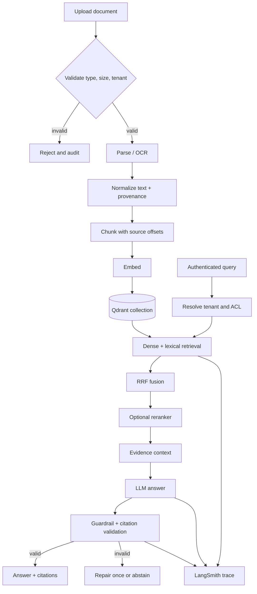
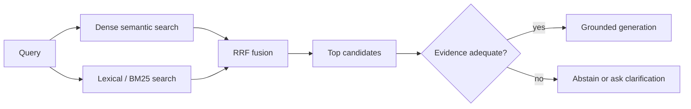
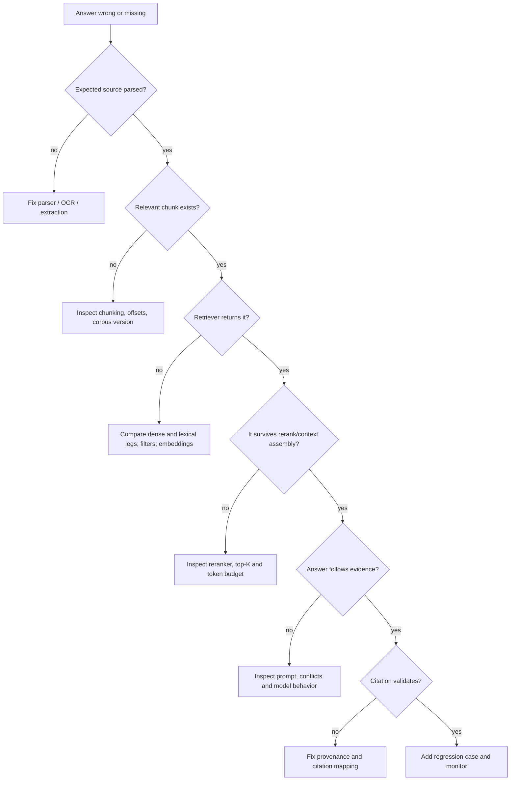

# Playbook 01 — Production RAG with Qdrant, LangSmith and Guardrails AI

## Outcome

Build a multi-tenant knowledge assistant that retrieves relevant evidence, respects document permissions, produces traceable answers and can explain why it failed. This is not a toy "embed then ask" demo.

## When to use RAG — and when not to

| Requirement | Prefer |
|---|---|
| Facts change frequently or must cite internal documents | RAG |
| Need to answer from private, permissioned knowledge | RAG with authorization filters |
| Need a consistent output format or domain behavior | Prompt/schema/guardrails first |
| Need the model to learn a stable task style or output transformation | Evaluate fine-tuning |
| Need exact deterministic business rules | Normal application code, not an LLM |
| Need current external facts | Approved live retrieval/API, not stale training data |

Fine-tuning does not replace retrieval for frequently changing facts. RAG does not reliably teach a model a new behavior by itself.

## Architecture and data flow



**Trust boundary:** tenant identity and document permissions come from verified server-side identity and database policy. Never accept a tenant ID or ACL filter supplied only by the browser or model.

## Lab 1 — Establish a reproducible baseline

Create a local Python environment and pin dependencies in a lock file. Keep exact versions in the project rather than copying floating versions from a tutorial.

```bash
python -m venv .venv
source .venv/bin/activate        # Windows: .venv\\Scripts\\activate
python -m pip install -U pip
pip install qdrant-client sentence-transformers fastapi uvicorn pydantic
```

Start Qdrant locally using its official Docker instructions. Use a disposable volume and a collection named `academy_kb_dev`. Record:
- embedding model name and immutable revision;
- vector dimension and distance metric;
- chunk size, overlap and parser version;
- corpus snapshot/hash;
- collection schema and payload indexes.

**Worked fixture:** create 12 synthetic policy chunks across two tenants. Include exact identifiers (`POL-017`), paraphrases, a stale policy, one duplicate, one chunk with a page number and one restricted chunk.

**Expected observation:** exact identifier queries should be strong on lexical retrieval; paraphrases should benefit from dense retrieval. Do not assume one retriever wins every query.

## Lab 2 — Design Qdrant points and payload

A point should contain a stable ID, vector(s), and payload with provenance and filterable fields. Example payload contract:

```json
{
  "tenant_id": "tenant-demo-a",
  "document_id": "policy-017",
  "chunk_id": "policy-017:p2:c4",
  "source_uri": "synthetic://policy-017",
  "page": 2,
  "section": "Refund exceptions",
  "acl_groups": ["support", "managers"],
  "document_version": 3,
  "is_current": true,
  "text": "Exceptions require manager approval."
}
```

Create payload indexes for fields used in filters (for example tenant, current-version and access group) before loading a meaningful corpus. Choose index types to match actual payload types. Do not index every field blindly: indexes consume resources.

**Practice task:** implement deterministic IDs from document version + page + chunk offset. Re-ingesting the same document version must be idempotent; a new version must not silently overwrite provenance.

**Verification:** duplicate ingestion, stale version, empty collection, malformed payload, tenant filter missing and ACL group mismatch.

## Lab 3 — Dense, lexical and hybrid retrieval

Run each retrieval leg independently before tuning fusion.



Use Qdrant's Query API and hybrid-query support for dense + sparse/full-text retrieval. Start with reciprocal-rank fusion (RRF) as a robust baseline when score scales are not calibrated. Tune weights only against a held-out evaluation set. Add reranking only after the first-stage candidate recall is measured.

**Experiment matrix:**
- dense only;
- lexical only;
- dense + lexical with RRF;
- hybrid + reranker;
- hybrid + metadata filters.

Report Recall@5, MRR@10 or nDCG@10, p50/p95 latency and cost per query. Keep a held-out set; do not tune and report on the same questions.

## Lab 4 — Authorization and isolation

For each query:
1. verify the access token server-side;
2. derive principal, tenant and groups from trusted claims/database;
3. construct mandatory Qdrant filters in trusted backend code;
4. retrieve only authorized candidates;
5. re-check source authorization before assembling context;
6. include only permitted evidence in the prompt;
7. log the policy decision without logging secrets or raw sensitive content.

**Red-team fixture:** create tenant A and tenant B documents with nearly identical content. Ask tenant A a question whose best answer exists only in tenant B. The correct result is no access to B's evidence, even if semantic similarity is high.

**Critical negative tests:** omitted tenant filter, forged tenant ID in request body, forged group, deleted permission, stale ACL cache, cross-tenant rerank candidate. All must fail closed.

## Lab 5 — Grounded generation and Guardrails AI

Define a typed answer contract with:
- answer text;
- citations containing document ID, page, chunk ID and quoted evidence span;
- confidence/evidence status (do not present an uncalibrated model score as probability);
- abstention reason where evidence is insufficient.

Use Guardrails AI validators for the output properties that can be checked deterministically. Keep authorization, business policy and citation existence checks in trusted application code. A validator is not a security boundary by itself.

**Validation pipeline:**
1. parse model output against schema;
2. ensure every cited chunk belongs to retrieved evidence;
3. ensure page and document identifiers match stored provenance;
4. verify claims have supporting spans or mark them unsupported;
5. reject unsafe/forbidden output;
6. retry a bounded repair once, then abstain.

Do not let a "repair" retry invent evidence. Record original output, validation errors and final disposition with sensitive values redacted.

## Lab 6 — LangSmith traces and evaluation

Trace these spans separately: request/auth, query rewrite, dense retrieval, lexical retrieval, fusion, reranking, prompt assembly, model call, guardrail validation and response serialization.

Attach safe metadata such as experiment ID, prompt version, embedding version, collection version, tenant pseudonym and latency. Do not attach secrets, raw access tokens or unredacted customer documents.

Build a dataset with at least 30 questions and expected relevant chunk IDs. Include:
- answerable and unanswerable questions;
- exact identifiers and paraphrases;
- conflicting and stale documents;
- multi-hop questions;
- malicious prompt-injection text inside a retrieved document;
- ACL denial cases.

Evaluate retrieval separately from generation. Suggested metrics: Recall@K, MRR/nDCG, context precision, answer correctness, faithfulness, citation precision, abstention quality, p95 latency and cost. Calibrate LLM-as-judge scores with human-reviewed examples; never use a judge score as the only release gate.

## Debugging decision tree



| Symptom | Likely boundary | Inspect first | Safe correction |
|---|---|---|---|
| No chunks returned | ingestion/index | parse count, collection, vector size | repair ingestion; verify collection and model |
| Relevant chunk absent | chunking/retrieval | offsets, dense-only, lexical-only | revise chunking/model/filter based on eval |
| Correct chunk filtered out | authorization/filter | trusted tenant and ACL claims | fix policy mapping; never remove ACL to "make it work" |
| Correct candidate lost | reranking/context | candidate ranks, reranker input, token budget | increase candidate pool or adjust reranker with held-out eval |
| Hallucinated answer | generation | evidence context and prompt | evidence-bounded answer; abstain when unsupported |
| Invalid citation | provenance | source ID/page/offset mapping | validate citation against persisted source metadata |
| Latency spike | dependency stage | per-span p95, payload size, model time | cap top-K, cache safe results, batch or timeout |
| Quality drift | corpus/model/prompt | version manifest and eval diff | rollback index/prompt/model bundle |

## Production hardening checklist

- [ ] Tenant and ACL filters are mandatory and server-derived.
- [ ] Document upload has MIME, size, page, malware and parser-time limits.
- [ ] Ingestion is asynchronous for expensive parsing/OCR/embedding.
- [ ] Re-ingestion is idempotent and versioned.
- [ ] Deletes propagate to chunks, caches and derived indexes.
- [ ] Retrieval and answer metrics have a golden evaluation set.
- [ ] Traces redact sensitive content and credentials.
- [ ] Timeouts, rate limits, quotas and concurrency caps exist.
- [ ] Backups, restore tests and index rebuild procedures are documented.
- [ ] Low-evidence responses abstain rather than fabricate.

## Improvement plan

**Baseline → measurable iteration:** first get a correct dense + lexical baseline; next add metadata filters and ACL tests; then RRF; then reranking; then citation validation; then online trace review. Change one factor at a time and retain the previous best configuration. Prefer measured retrieval improvements over increasing prompt complexity.

## Official references

- Qdrant hybrid queries: https://qdrant.tech/documentation/hybrid-queries/
- Qdrant filtering: https://qdrant.tech/documentation/search/filtering/
- Qdrant payload indexes: https://qdrant.tech/documentation/manage-data/payload/
- LangSmith evaluation: https://docs.smith.langchain.com/evaluation
- LangSmith observability: https://docs.smith.langchain.com/observability
- Guardrails AI: https://guardrailsai.com/docs
