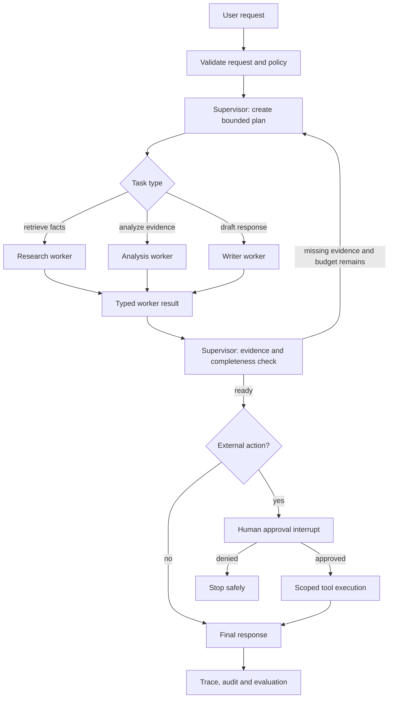
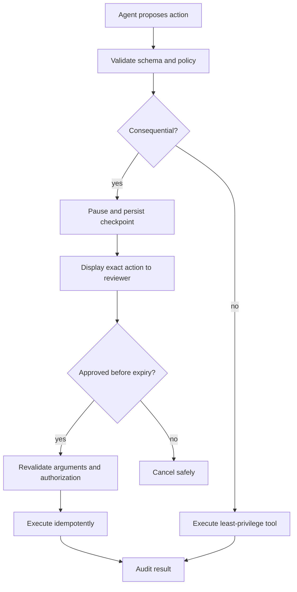

# Playbook 02 — Multi-agent systems with LangGraph and FastMCP

## Outcome

Build a bounded multi-agent workflow with specialist workers, explicit state transitions, scoped tools, checkpoints, human approval and trace-based evaluation. Learn when multiple agents are justified and when a deterministic chain is better.

## Choose the simplest architecture that works

| Pattern | Use when | Main risk |
|---|---|---|
| Single tool-calling agent | One agent can solve a bounded task | Tool loop or poor tool selection |
| Sequential chain | Steps are known and stable | Rigid path |
| Router | Requests map to distinct specialist domains | Misrouting |
| Supervisor + workers | A coordinator must delegate and synthesize | Extra latency, duplicated work, supervisor bottleneck |
| Parallel workers | Independent subtasks can run concurrently | Conflicting outputs and fan-out cost |
| Swarm/handoff | Agents need peer handoff and local ownership | Harder global control and termination |

Do not create agents just because a task has multiple steps. A normal function call is cheaper, easier to test and more predictable.

## Reference graph



## Lab 1 — Define typed state before agents

Create a state schema with explicit fields:
- `request_id`, `user_goal`, `plan`;
- `messages` or compact task history;
- `evidence[]` with source IDs and citations;
- `worker_results[]` with worker, status and timestamps;
- `remaining_steps`, `deadline_at`, `token_budget`;
- `approval_status` and `final_result`.

Keep sensitive identity and authorization context outside model-editable state. The graph may carry a server-issued principal reference, but workers must not be able to rewrite it.

**Exercise:** create a typed state object and unit-test valid, missing, oversized and contradictory values before building any graph nodes.

## Lab 2 — Implement the graph in stages

Install LangGraph and the model provider SDK selected for the lab. Start with deterministic fake workers so graph control flow can be tested without model calls.

```python
from typing import TypedDict, Literal
from langgraph.graph import StateGraph, START, END

class ResearchState(TypedDict, total=False):
    goal: str
    plan: list[str]
    evidence: list[dict]
    worker_results: list[dict]
    remaining_steps: int
    final_answer: str
    status: Literal["running", "needs_review", "done", "failed"]

def plan_node(state: ResearchState) -> ResearchState:
    if state.get("remaining_steps", 0) <= 0:
        return {"status": "failed"}
    return {"plan": ["research", "synthesize"], "status": "running"}

def research_node(state: ResearchState) -> ResearchState:
    return {
        "evidence": [{"source_id": "fixture-1", "text": "Synthetic evidence"}],
        "remaining_steps": state["remaining_steps"] - 1,
    }

def synthesize_node(state: ResearchState) -> ResearchState:
    evidence = state.get("evidence", [])
    return {"final_answer": "Evidence count: " + str(len(evidence)), "status": "done"}

graph = StateGraph(ResearchState)
graph.add_node("plan", plan_node)
graph.add_node("research", research_node)
graph.add_node("synthesize", synthesize_node)
graph.add_edge(START, "plan")
graph.add_edge("plan", "research")
graph.add_edge("research", "synthesize")
graph.add_edge("synthesize", END)
app = graph.compile()
```

This is a control-flow skeleton, not a production agent. Add conditional routing only after deterministic tests pass. Then replace one fake worker with a model-backed worker behind a typed input/output adapter.

## Lab 3 — Supervisor and worker contracts

Define each worker as a narrow capability:
- Research worker: retrieve evidence; cannot send messages or mutate records.
- Analysis worker: compare evidence and identify uncertainty; cannot invent citations.
- Writer worker: format supported conclusions; cannot call external tools.
- Reviewer: check completeness, citations and policy; can return structured findings.

Worker output must include `status`, `summary`, `evidence_ids`, `warnings`, `next_action`. Validate it before adding to graph state.

**Worked failure:** a worker returns a confident paragraph with no evidence IDs. The supervisor must reject it or request evidence, not silently accept the prose.

## Lab 4 — Add persistence, checkpoint and recovery

Use an appropriate LangGraph checkpointer for the chosen environment. SQLite is suitable for local learning; use a supported durable store for a multi-instance production deployment. Define thread identity server-side and never allow one user to resume another user's thread.

Test:
1. start graph and persist checkpoint;
2. simulate process termination after a worker result;
3. resume from the saved checkpoint;
4. verify completed side effects are not repeated;
5. verify a changed state schema has a migration/compatibility plan.

Checkpointing does not make external side effects exactly-once. Use idempotency keys and transactional outbox patterns where appropriate.

## Lab 5 — Human approval and consequential actions

Pause before actions that send, purchase, delete, publish, grant access or modify customer data. Show the exact operation, target, arguments and impact to the approver. Bind approval to a specific action hash and expire it. If arguments change, require new approval.



## Lab 6 — FastMCP tool server

Create a local FastMCP server that exposes one harmless read-only tool, such as searching a synthetic knowledge base. Keep tool schemas narrow, validate inputs, cap result size and use structured errors. Build a separate client that discovers and invokes the tool. Verify initialize/capability negotiation, tool listing, invocation, cancellation and shutdown against the SDK version you pin.

Security drills:
- malicious tool description attempts to override system policy;
- argument contains path traversal or an unexpected URL;
- tool attempts to read a file outside its allowed root;
- client reconnects after server restart;
- oversized result attempts to exhaust context;
- credentials accidentally appear in logs.

For remote deployment, use the transport and authentication model supported by the pinned FastMCP release. Do not assume local stdio security properties apply to remote HTTP. For stdio, keep stdout exclusively for protocol messages and send diagnostics to stderr.

## Lab 7 — LangSmith observability and agent evaluation

Trace graph run ID, node name, worker identity, tool name, retry count, checkpoint ID, token use, latency and termination reason. Redact private inputs and secrets.

Build a 25-task dataset containing:
- clear single-worker tasks;
- tasks requiring multiple workers;
- ambiguous requests;
- conflicting evidence;
- tool timeout and malformed output;
- worker disagreement;
- budget exhaustion;
- approval denied/expired;
- duplicate tool delivery;
- prompt injection in retrieved evidence.

Measure task success, evidence correctness, tool-call precision, policy violations, loops, latency, tokens and cost. Inspect traces to find the exact node where behavior diverges.

## Failure diagnosis table

| Symptom | Inspect | Likely correction |
|---|---|---|
| Agent loops | state transitions, remaining-step counter, termination edge | explicit stop condition and hard recursion budget |
| Wrong worker selected | router input and route labels | narrower typed route schema and router eval cases |
| Worker contradicts another | evidence IDs, source freshness, worker contract | evidence-first merge and conflict surfaced to user |
| Duplicate side effect after resume | checkpoint boundary and idempotency key | persist intent/result; idempotent tool |
| State grows without bound | messages, evidence and checkpoint size | summarize with provenance; cap state fields |
| Approval applies to changed action | approval payload hash | bind approval to canonical action arguments |
| MCP tool called with unsafe args | schema, principal, allowlist | validate and authorize inside server/tool boundary |
| Slow multi-agent run | per-node traces and fan-out | parallelize only independent work; remove unnecessary agents |

## Mastery project

Build a read-only research workflow with supervisor, two specialist workers, one FastMCP tool, LangSmith tracing, max-step budget, checkpoint recovery and a human approval gate for one simulated consequential action.

**Pass criteria:** 20 deterministic tests, 10 model-backed evaluation tasks, no cross-user checkpoint access, no unauthorized tool invocation, bounded termination and a trace for every run.

## Improvement plan

Start with a single deterministic graph. Add one model-backed worker. Add a supervisor only when routing or synthesis measurably improves results. Add parallel workers only when subtasks are independent. Add persistence before long-running operations. Add approval before any consequential side effect. Compare each stage against the previous simpler baseline.

## Official references

- LangGraph overview: https://docs.langchain.com/oss/python/langgraph/overview
- LangGraph persistence: https://docs.langchain.com/oss/python/langgraph/persistence
- LangGraph interrupts: https://docs.langchain.com/oss/python/langgraph/interrupts
- LangGraph multi-agent: https://docs.langchain.com/oss/python/langgraph/multi-agent
- LangSmith: https://docs.smith.langchain.com/
- FastMCP: https://gofastmcp.com/
- MCP specification: https://modelcontextprotocol.io/specification/
