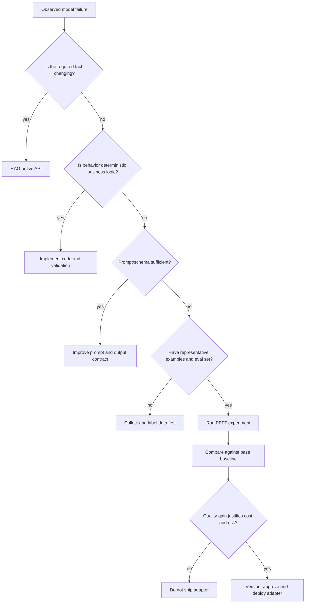

# Playbook 03 — Fine-tuning with LoRA and QLoRA

## Outcome

Prepare a high-quality instruction dataset, establish a base-model baseline, train a parameter-efficient adapter when justified, evaluate regressions and package a reproducible release. The goal is to learn the complete engineering lifecycle—not to claim that a training run happened on hardware that was not available.

## Decide whether fine-tuning is appropriate



Fine-tuning is useful for stable task behavior, style, classification patterns or domain-specific transformations. It is not a reliable way to inject frequently changing private facts or enforce authorization.

## Lab 1 — Build a dataset you can trust

Create a versioned JSONL dataset. Keep train, validation and test splits separated by source/customer/time where leakage is possible.

Example record:

```json
{"messages":[{"role":"system","content":"Return a concise support classification."},{"role":"user","content":"My order arrived damaged."},{"role":"assistant","content":"{\"category\":\"damaged_item\",\"priority\":\"high\"}"}]}
```

Dataset checks:
- remove secrets, personal data and unauthorized content;
- deduplicate exact and near-duplicate examples;
- validate role order and schema;
- detect conflicting labels and malformed JSON;
- split by source entity to prevent near-duplicate leakage;
- document language, domain, exclusions and known bias;
- preserve a held-out test set that is not used for prompt or hyperparameter tuning.

**Exercise:** create 100 synthetic examples, 80/10/10 split by scenario family. Inject 10 deliberate defects and write tests that detect them.

## Lab 2 — Establish a base-model baseline

Before training, run the untouched base model on the held-out test set. Store:
- model ID and immutable revision;
- tokenizer revision;
- prompt and decoding settings;
- dataset hash;
- exact test cases and raw outputs;
- task metrics, latency and token cost.

For structured outputs, measure schema-valid rate and field-level precision/recall. For generation, use task-specific rubrics and human-reviewed examples. Save failure categories, not just one aggregate score.

## Lab 3 — Understand LoRA mathematically

For a frozen weight matrix (W), LoRA learns a low-rank update:

[
W' = W + Delta W,qquad Delta W = rac{\alpha}{r}BA
]

where (A) and (B) are trainable low-rank matrices and (r) is the rank. The base weights remain frozen. Increasing rank increases adapter capacity and trainable parameters; it is not automatically better.

Compare:
- full fine-tuning;
- LoRA;
- QLoRA (quantized frozen base + trainable adapter);
- prompt engineering / few-shot baseline.

QLoRA reduces memory requirements but still needs compatible hardware, quantization support and enough memory for activations, optimizer state and batch processing.

## Lab 4 — Configure a PEFT experiment

Install the relevant versions of Transformers, PEFT, TRL and the selected quantization backend. Pin them. Select a small model whose license and hardware requirements permit the exercise.

Illustrative configuration (adapt target module names to the chosen model architecture):

```python
from peft import LoraConfig, TaskType

lora_config = LoraConfig(
    task_type=TaskType.CAUSAL_LM,
    r=8,
    lora_alpha=16,
    lora_dropout=0.05,
    target_modules=["q_proj", "v_proj"],
)
```

Training setup must explicitly record:
- base model and revision;
- tokenizer and chat template;
- dataset fingerprint;
- max sequence length and truncation policy;
- batch size, gradient accumulation and learning rate;
- epochs, warmup, scheduler, seed;
- precision and quantization settings;
- checkpoint and adapter output locations.

Do not assume every model uses `q_proj` and `v_proj`; inspect the architecture and verify trainable parameter names. Run a one-batch smoke test before a full experiment.

## Lab 5 — Evaluate and diagnose

Compare adapter and base model on the same held-out examples and decoding settings. Report:
- task success / exact match where appropriate;
- structured schema-valid rate;
- precision, recall and F1 for classification;
- hallucination or unsupported-claim rate;
- refusal/safety regression;
- latency, memory and cost;
- performance by language, scenario and difficulty.

**Failure drills:**
- training loss falls but validation quality worsens (overfit);
- adapter has no measurable effect (wrong target modules or adapter not loaded);
- output format regresses (dataset/template mismatch);
- model forgets general capability (too narrow or excessive training);
- evaluation score rises only on duplicated examples (data leakage);
- QLoRA fails at load time (unsupported quantization/backend/hardware mismatch).

Do not ship based only on training loss.

## Lab 6 — Package and serve the adapter

Create an immutable manifest containing base model revision, tokenizer revision, adapter artifact hash, PEFT config, training dataset hash, training code commit, evaluation report, license, approval and rollback target.

Test:
1. base model + no adapter;
2. base model + adapter;
3. adapter load failure;
4. wrong base-model revision;
5. tokenizer mismatch;
6. rollback to previous release.

Keep adapters separate from the base model when operationally useful. Do not merge adapters into base weights unless there is a deliberate, tested packaging decision.

## Debugging map

| Symptom | First inspect | Improvement |
|---|---|---|
| CUDA OOM | sequence length, batch, activation memory, quantization | lower batch/sequence, gradient accumulation, supported checkpointing |
| Loss NaN | learning rate, precision, bad samples, gradient norm | lower LR, inspect samples, stable precision |
| No learning | trainable parameter count, target modules, labels | confirm adapter attached and labels/masking correct |
| Train improves, test degrades | split leakage, epochs, data diversity | early stop, improve split and data |
| Adapter changes style but not task | examples and target objective | add balanced task-specific examples and metrics |
| Inference differs from training | tokenizer/chat template/decoding | version the full compatible bundle |
| Slow serving | base load, adapter switching, batching | warm model, batch requests, measure adapter strategy |

## Mastery project

Train or fully simulate the release process for a small task-specific adapter. Submit dataset card, baseline report, PEFT config, training logs (if training actually ran), held-out evaluation, adapter manifest and rollback evidence. If compute is unavailable, submit a reproducible dry-run plan and clearly label it as not trained.

## Improvement plan

Improve dataset quality before increasing model size or LoRA rank. Establish a base baseline, change one training parameter at a time, keep the held-out test fixed, and require a measurable quality gain without safety or latency regression. If RAG or deterministic code solves the problem more reliably, do not fine-tune.

## Official references

- Transformers PEFT: https://huggingface.co/docs/transformers/peft
- PEFT LoRA: https://huggingface.co/docs/peft/main/conceptual_guides/lora
- Quantized fine-tuning / QLoRA: https://huggingface.co/docs/transformers/quantization/finetune
- TRL: https://huggingface.co/docs/trl/
