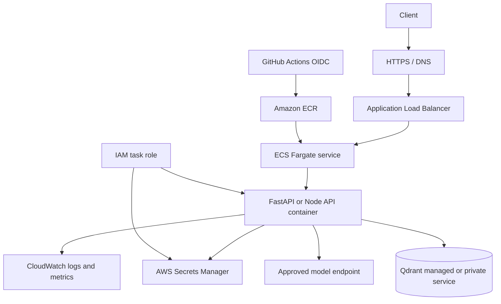
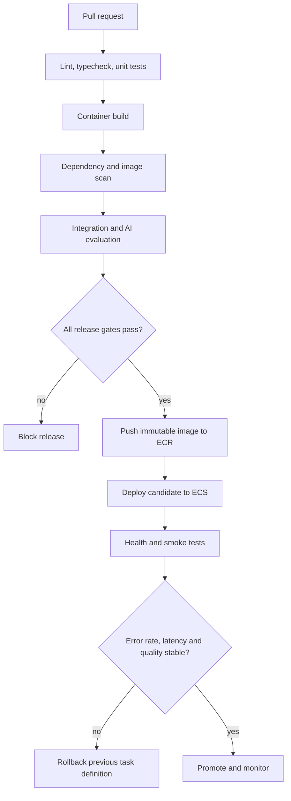

# Playbook 04 — Deploy an AI API on AWS

## Outcome

Understand and rehearse a secure, observable container deployment using ECR and ECS Fargate. The lab does not provision AWS resources automatically. Use a sandbox account only after reviewing cost, region, identity, network and teardown.

## Reference deployment



A production design may place the load balancer in public subnets and tasks in private subnets. Data services should be private. Choose managed Qdrant or a self-managed vector service only after comparing operational ownership, data residency, backup and cost. Do not expose Qdrant directly to the public internet.

## Lab 1 — Containerize and test locally

Build a small API with:
- `/health/live`: process liveness only;
- `/health/ready`: dependency readiness with bounded timeout;
- request ID and structured JSON logs;
- non-root container user;
- pinned dependencies and reproducible build;
- graceful SIGTERM handling;
- request size, concurrency and timeout limits.

Example Dockerfile pattern:

```dockerfile
FROM python:3.12-slim
ENV PYTHONDONTWRITEBYTECODE=1 PYTHONUNBUFFERED=1
WORKDIR /app
RUN useradd --create-home appuser
COPY requirements.txt .
RUN pip install --no-cache-dir -r requirements.txt
COPY app ./app
USER appuser
EXPOSE 8000
CMD ["uvicorn", "app.main:app", "--host", "0.0.0.0", "--port", "8000"]
```

Add a `HEALTHCHECK` suitable for the chosen base image/runtime, and ensure the app binds to the configured container port. Do not bake secrets into image layers or build arguments.

## Lab 2 — Build and publish to ECR

Practice the workflow:
1. create a repository in the approved region;
2. authenticate Docker to ECR;
3. build an immutable image tag from commit SHA;
4. scan and inspect the image;
5. push the image;
6. record the image digest;
7. deploy the digest, not a mutable `latest` tag.

Never store long-lived AWS access keys in GitHub secrets when GitHub Actions OIDC with a narrowly scoped IAM role is available. Restrict the role trust policy to the exact repository and branch/environment.

## Lab 3 — ECS Fargate task and service

Understand the resources before applying:
- task definition: image, CPU/memory, ports, environment references, logs, execution role and task role;
- service: desired count, subnets, security groups, load balancer target group, deployment circuit breaker;
- target group: health check path and healthy thresholds;
- autoscaling: CPU/memory/request metrics and min/max task counts.

Separate the **task execution role** (pull image, write logs, retrieve startup secrets as needed) from the **task role** (application runtime access). Give each only the actions it needs. Avoid wildcard resource access.

## Lab 4 — Networking and secrets

Create a traffic diagram and verify:
- inbound internet traffic reaches only HTTPS listener;
- task ingress is allowed only from the load balancer security group;
- task egress is limited to required dependencies where practical;
- database/vector store is private;
- secrets are fetched at runtime through IAM;
- TLS is enforced at the edge and service-to-service where required;
- no credentials appear in environment dumps, traces or exception logs.

Use Secrets Manager or Systems Manager Parameter Store according to rotation and operational needs. Rotate credentials and test failure behavior when a secret is unavailable.

## Lab 5 — CI/CD and safe deployment



For AI services, post-deploy checks should include model connectivity, retrieval smoke cases, schema validity, citations and policy tests—not just HTTP 200. Store the previous known-good task definition and image digest.

## Lab 6 — Observability and operations

Emit structured logs with request ID, route, status, duration, model/provider, retrieval collection version and safe error code. Avoid raw prompts and personal data by default.

Monitor:
- request rate, 4xx/5xx and throttling;
- p50/p95/p99 latency;
- task CPU/memory and restarts;
- dependency timeout/error rate;
- LLM token use and spend;
- retrieval recall/quality on sampled evaluation;
- guardrail rejection and abstention rate;
- queue depth and ingestion age if async workers exist.

Create alerts with actionable runbooks. A CPU alarm without a runbook is not operational readiness.

## Failure and recovery drills

| Symptom | Inspect | Immediate mitigation | Durable fix |
|---|---|---|---|
| ECS task exits | stopped reason, container logs, exit code | restore last known-good task definition | reproduce locally; fix config/startup |
| ALB 502/503 | target health, port, SG, readiness | rollback or restore healthy target | align port/health check and startup behavior |
| Image pull denied | execution role, ECR repo policy, region | restore permissions for known role | least-privilege ECR policy and OIDC |
| Secret unavailable | task execution role, secret ARN/region, KMS | rollback secret/config change | validate IAM and rotation path |
| OOM / task killed | memory metrics, model load, concurrency | reduce concurrency or model footprint | capacity test and right-size task |
| Slow cold start | image size, model download, dependency init | keep warm only if cost approved | slim image, prefetch approved artifacts |
| Model provider throttles | provider status, retry-after, concurrency | bounded backoff and admission control | quotas, queueing and circuit breaker |
| New version regresses | deployment version, eval report, traces | rollback immutable digest | add failing case to release gate |

## Cost and teardown discipline

Before any apply:
- estimate ALB, Fargate CPU/memory-hours, ECR storage, logs, NAT gateway, data transfer, database/vector service and model inference;
- set an AWS Budget and alert;
- choose explicit minimum/maximum task counts;
- set CloudWatch log retention;
- understand that NAT gateways and always-on load balancers can cost money even at low traffic;
- avoid GPU instances unless the workload and budget justify them;
- document exact resource names and teardown order.

After the lab, delete only resources created for the lab, verify no load balancer, NAT gateway, task, volume, snapshot, log retention or public IP remains, and check the billing console. Do not assume stopping a service removes all charges.

## Mastery project

Deploy a small stateless AI API in a sandbox with ECR, ECS Fargate, least-privilege IAM, secret reference, HTTPS ingress, CloudWatch logs, CI image build, post-deploy smoke test and rollback drill. Submit architecture diagram, threat model, IAM policy review, image digest, deployment evidence, cost estimate and teardown proof.

## Improvement plan

First deploy a non-LLM health API. Then add a model provider call. Next add retrieval as an external dependency. Add async workers only when ingestion or long-running jobs require them. Add autoscaling after measuring demand. Keep model inference external or managed until GPU hosting is justified. Every new managed service must have an owner, budget, backup and teardown plan.

## Official references

- ECS developer guide: https://docs.aws.amazon.com/AmazonECS/latest/developerguide/Welcome.html
- Fargate: https://docs.aws.amazon.com/AmazonECS/latest/developerguide/AWS_Fargate.html
- ECR: https://docs.aws.amazon.com/AmazonECR/latest/userguide/what-is-ecr.html
- IAM roles for tasks: https://docs.aws.amazon.com/AmazonECS/latest/developerguide/task-iam-roles.html
- GitHub Actions OIDC with AWS: https://docs.aws.amazon.com/IAM/latest/UserGuide/id_roles_providers_create_oidc.html
- Secrets Manager: https://docs.aws.amazon.com/secretsmanager/latest/userguide/intro.html
- CloudWatch: https://docs.aws.amazon.com/AmazonCloudWatch/latest/monitoring/WhatIsCloudWatch.html
