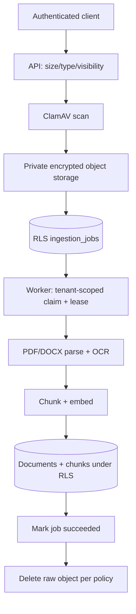

# Production RAG Ingestion: Queue, Storage and Tenant Isolation

## Architecture

The upload API validates request size, declared file type, tenant visibility and malware-scan policy. It writes the original bytes to a private object store and inserts a tenant-scoped `ingestion_jobs` row. A separate tenant-scoped worker claims jobs using `FOR UPDATE SKIP LOCKED`, sets a lease, renews the lease during long parsing/embedding work, and writes the document/chunks under transaction-local tenant RLS. The API returns a job ID; clients poll the job status endpoint.



## Database rollout

1. Back up the database and verify a restore in a non-production environment.
2. Apply migrations in order: `000_local_role.sql`, `001_initial.sql`, `002_document_acl_ingestion_jobs.sql`.
3. Confirm the runtime DB role is not a superuser, table owner or BYPASSRLS role.
4. Run `ACADEMY_TEST_DATABASE_URL=<restricted-role-url> python -m pytest backend/tests/test_tenant_isolation.py -q` from the repository root after setting the test URL to a disposable database.
5. Verify forced RLS on documents, chunks, document_acl and ingestion_jobs before accepting uploads.

## Worker operations

Run a worker with a trusted tenant scope:

```bash
cd backend
python -m app.worker --tenant-id <trusted-tenant-uuid>
```

The tenant UUID is operator configuration and must not come from an HTTP request. Scale by running separate worker processes per tenant or a trusted scheduler that launches tenant-scoped workers. The worker has bounded retries, exponential backoff, a renewable lease and a terminal dead state. Alert on oldest queued job age, retry count, dead jobs, lease expiry and worker heartbeat.

## Storage and malware controls

- Local filesystem storage is development-only; it uses restrictive directory/file permissions and rejects traversal keys.
- Production object storage must be private, use SSE-KMS, deny public access, and enforce lifecycle/retention policies.
- Set `ACADEMY_MALWARE_SCAN_REQUIRED=true` and configure ClamAV for untrusted/public uploads. Missing or unavailable scanner fails closed.
- Raw objects are deleted after successful processing and on malware rejection. Failed jobs may retain objects for bounded operational review; implement and test an explicit retention/cleanup job before production.
- Never log file contents, extracted text, access tokens or raw prompts.

## Document authorization

Documents default to `private`. Tenant-wide visibility is an administrator-only choice. List and search enforce owner/tenant visibility/explicit user ACL grants. ACL rows are tenant-scoped and RLS-protected. Do not expose a grant/revoke endpoint until the actual identity provider can prove that the target user is a member of the same tenant. Cross-tenant RLS tests must remain green.

## Rollback

- Stop worker processes first; queued jobs remain durable.
- Roll back API code only after confirming it no longer expects migration 002. Do not drop ACL/job tables while rows exist.
- Retain private raw objects until job/document consistency is reconciled; never bulk-delete objects based only on a failed API response.
- Re-enable workers after DB schema and code versions are compatible.

## Deployment boundary

This repository change adds code and local Compose wiring only. It does not create cloud buckets, KMS keys, ClamAV hosts, databases, worker services, DNS, credentials or paid infrastructure. Before deployment, configure secrets outside source control, test object-store IAM and KMS policy, validate backup/restore, run load/security testing and complete the identity-provider integration.


## Embeddings and grounded answer provider

The backend supports a local SentenceTransformers adapter and an opt-in OpenAI-compatible remote `/embeddings` adapter. Remote mode validates vector count, order, dimension and finite values. Use a dedicated private endpoint and review provider data-retention terms before sending customer text. It is disabled by default.

The `POST /v1/answer` route is disabled unless `ACADEMY_GENERATION_ENABLED=true` and the model endpoint, API key and model name are configured. The adapter sends only ACL-filtered, bounded evidence, treats retrieved text as untrusted data, requests structured JSON and verifies each citation source ID and exact quote span. Invalid citations and model abstention return an empty abstained answer. This is a syntactic citation gate, not proof of semantic entailment; evaluate answer faithfulness, contradictions, prompt injection and no-answer behavior before enabling the endpoint for users.

Keep all provider keys in a secret manager or deployment environment. Never commit provider keys or log raw prompts, evidence, answers or authorization tokens. Start with synthetic data and a non-production provider account.
