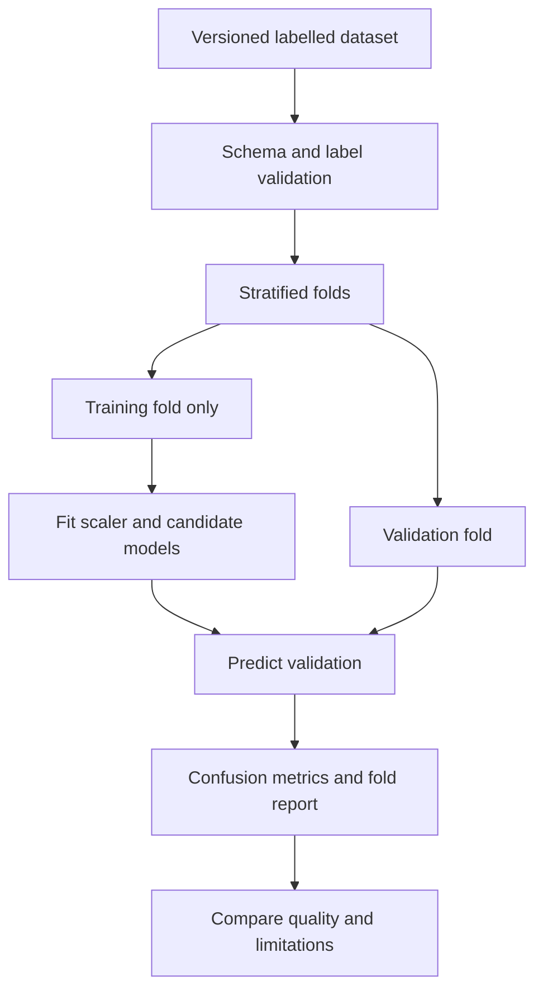

# Stage 2 model-comparison data flow

## Evaluation contract
Each fold stores train/validation row counts, scaler fit count and an explicit validation-used-for-fit=false invariant. Model selection must use the same folds and metrics; the final test set remains untouched until selection is complete.
