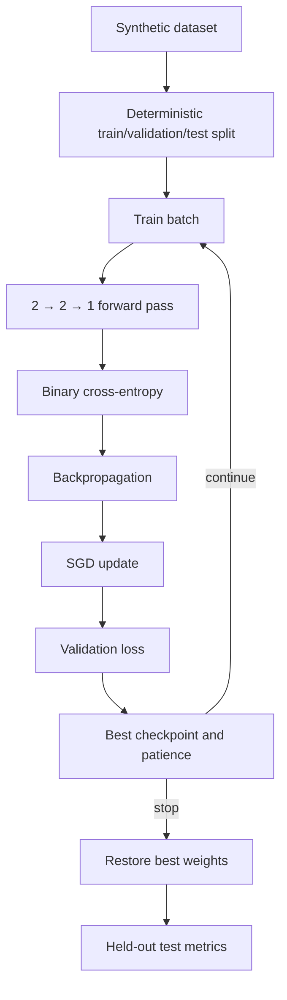

# Stage 3 project data flow and tensor shapes

| Tensor | Shape | Meaning |
|---|---:|---|
| Input batch | (B,2) | Two numeric features |
| Hidden weights | (2,2) | Two hidden units × two features |
| Hidden activations | (B,2) | Tanh outputs |
| Output weights | (2,) | Hidden-to-output weights |
| Probability output | (B,1) | Sigmoid score |
| Target | (B,) | Binary label |

Train, validation and test rows are disjoint. Validation loss controls checkpoint selection; the test partition is not used for updates or early stopping.
